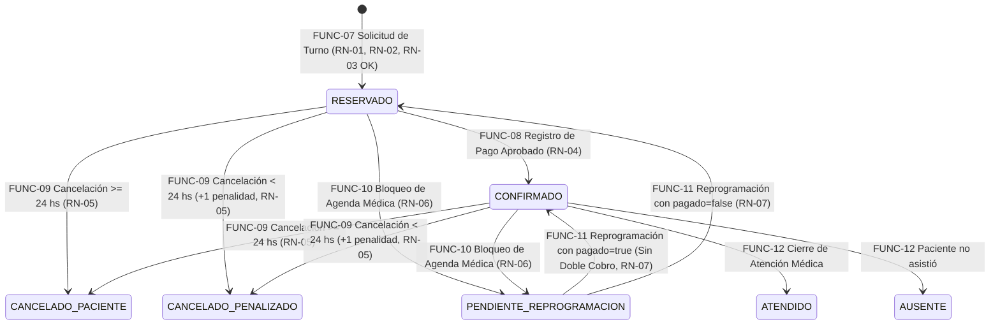
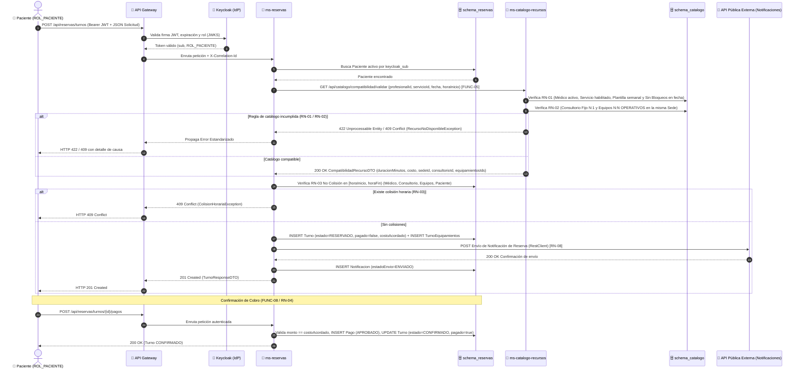
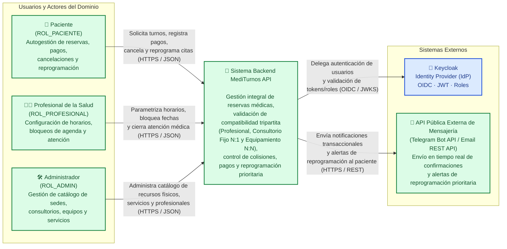
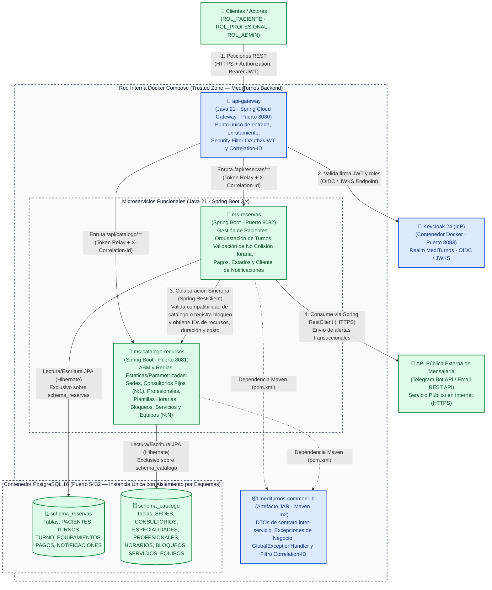

# 🏥 MediTurnos API — Sistema Integral de Gestión de Turnos y Compatibilidad Tripartita de Recursos

> **Trabajo Práctico Integrador (TPI) — Backend de Aplicaciones (2026)**  
> **Universidad Tecnológica Nacional — Facultad Regional Córdoba (UTN FRC)**  
> Plataforma backend orientada a microservicios desarrollada con Java 21, Spring Boot 3, Spring Cloud Gateway, Keycloak y PostgreSQL.

---

## 👥 Identificación del Equipo

- **Equipo:** Grupo 06
- **Comisión:** 3K4
- **Integrantes:**
  - **Paglino, Luciano Ivo** — Legajo: `95738` *(Responsable de contacto: `lupaglino@gmail.com`)*
  - **Barba Zelaya, Marcia** — Legajo: `413219`
  - **Bossi, Augusto** — Legajo: `87917`
  - **Marinelli, Nicolás** — Legajo: `410241`
  - **Ramírez, Hernán** — Legajo: `83397`
- **Repositorio Principal:** [https://github.com/lucianopgl/MediTurnos](https://github.com/lucianopgl/MediTurnos)

---

## 📋 Índice

1. [Explicación del Dominio y Contexto del Problema](#-1-explicación-del-dominio-y-contexto-del-problema)
2. [Propuesta de Valor y Actores Involucrados](#-2-propuesta-de-valor-y-actores-involucrados)
3. [Alcance Funcional del MVP, Reglas de Negocio y Proceso Principal](#-3-alcance-funcional-del-mvp-reglas-de-negocio-y-proceso-principal)
   - [3.1. Funcionalidades Comprometidas y Exclusiones](#31-funcionalidades-comprometidas-del-mvp)
   - [3.2. Reglas de Negocio y Máquina de Estados del Turno](#32-reglas-de-negocio-y-máquina-de-estados-del-turno)
   - [3.3. Proceso de Negocio Principal y Diagrama de Secuencia](#33-proceso-de-negocio-principal-de-extremo-a-extremo)
4. [Arquitectura y Matriz de Validación Técnica](#-4-arquitectura-y-matriz-de-validación-técnica)
5. [Diagramas de Arquitectura (Modelo C4)](#-5-diagramas-de-arquitectura-modelo-c4)
   - [5.1. C1 — Diagrama de Contexto del Sistema](#51-c1--diagrama-de-contexto-del-sistema)
   - [5.2. C2 — Diagrama de Contenedores](#52-c2--diagrama-de-contenedores)
6. [Recursos y Endpoints por Microservicio (APIs REST)](#-6-recursos-y-endpoints-por-microservicio-apis-rest)
7. [Modelo de Datos — Diagrama Entidad-Relación (DER)](#-7-modelo-de-datos--diagrama-entidad-relación-der)
8. [Registro de Decisiones de Arquitectura (ADRs)](#-8-registro-de-decisiones-de-arquitectura-adrs)
9. [Stack Tecnológico, Estructura y Despliegue](#-9-stack-tecnológico-estructura-y-despliegue)
10. [Criterios de Verificación y Hoja de Ruta](#-10-criterios-de-verificación-y-hoja-de-ruta)

---

## 🩺 1. Explicación del Dominio y Contexto del Problema

En las clínicas y centros de diagnóstico ambulatorios que operan con múltiples sedes físicas, la programación eficiente de turnos médicos no depende únicamente de la agenda individual del médico. Para que una prestación médica pueda llevarse a cabo, deben coincidir simultáneamente en el mismo edificio y franja horaria tres recursos críticos con distintas restricciones:

1. **El Profesional de la Salud:** Atiende en días y horarios parametrizados, realiza únicamente determinados estudios o prácticas dentro de su especialidad y puede sufrir imprevistos (congresos, guardias o licencias) que obligan a bloquear su agenda en una fecha puntual.
2. **El Espacio Físico (Consultorio Fijo compartido `N:1`):** Cada médico tiene asignado un consultorio fijo de referencia dentro de una sede; sin embargo, ese mismo consultorio suele ser compartido por varios profesionales que rotan en distintos turnos. Si dos médicos que comparten consultorio superponen horarios, se genera un conflicto físico de espacio.
3. **El Equipamiento Médico de Diagnóstico (`N:N`):** Prácticas como ecografías Doppler, electrocardiogramas o ergometrías requieren uno o varios equipos médicos que son escasos y compartidos entre múltiples servicios y profesionales de la sede.

El dominio de **MediTurnos API** abarca la **Gestión Integral de Reservas y Compatibilidad Tripartita de Recursos**. Su objetivo central es coordinar la agenda médica validando sin acoplamiento circular la disponibilidad simultánea entre profesionales, consultorios fijos y equipamientos en la misma sede, gestionando la confirmación de cobros, las penalizaciones por cancelación tardía ($< 24\text{ hs}$), la reprogramación prioritaria sin doble cobro y el envío en tiempo real de notificaciones externas al paciente.

> **Acotación de Alcance del MVP:**  
> Se excluyen explícitamente las validaciones con Obras Sociales (operando sobre los aranceles estipulados por cada servicio), los flujos conversacionales bidireccionales de Chatbot y los webhooks asíncronos de pasarelas bancarias externas, concentrando el MVP en un flujo transaccional directo, atómico y 100% verificable.

---

## 👥 2. Propuesta de Valor y Actores Involucrados

- **Pacientes (`ROL_PACIENTE`):** Autogestión para consultar el catálogo disponible, registrar su perfil (vinculado al claim `sub` UUID del token JWT emitido por Keycloak), reservar turnos, registrar el pago para confirmar su cita, cancelar o reprogramar prioritariamente sin doble cobro ante ausencias médicas, recibiendo alertas automatizadas.
- **Profesionales de la Salud (`ROL_PROFESIONAL`):** Control de agenda médica. Cada profesional define su **plantilla horaria semanal parametrizada**, registra **bloqueos puntuales por fecha** ante eventualidades, tiene asignado un **consultorio fijo (`N:1`)**, cuenta con una nómina de **servicios médicos habilitados (`N:N`)** y registra el cierre de atención (`ATENDIDO` / `AUSENTE`).
- **Administradores (`ROL_ADMIN`):** Gestión integral del catálogo de sedes físicas, alta y mantenimiento (`operativo = true/false`) de consultorios y equipamientos de diagnóstico, configuración de especialidades y servicios (con duraciones y costos parametrizados) y supervisión global de turnos y notificaciones.
- **Gestión de Identidades Externa (`Keycloak`):** La administración de credenciales, autenticación OIDC y emisión de tokens JWT con roles se delega íntegramente al Identity Provider **Keycloak**.

---

## ⚙️ 3. Alcance Funcional del MVP, Reglas de Negocio y Proceso Principal

### 3.1. Funcionalidades Comprometidas del MVP

| ID | Nombre de la Funcionalidad | Actor Principal | Comportamiento Esperado | Resultado Observable | Prioridad |
| :--- | :--- | :--- | :--- | :--- | :--- |
| **FUNC-01** | Gestión de Sedes, Consultorios y Equipamientos | `ROL_ADMIN` | Permite dar de alta, consultar y actualizar el estado operativo (`operativo = true/false`) de sedes físicas, consultorios y equipamientos de diagnóstico asociados a una sede. | Recursos físicos persistidos en `schema_catalogo` con su estado operativo vigente y sede asignada. | **Alta (MVP)** |
| **FUNC-02** | Gestión de Especialidades y Servicios Médicos | `ROL_ADMIN` | Permite registrar especialidades y tipos de servicios médicos parametrizando su `duracionMinutos`, `costo` y la lista de equipamientos requeridos (`N:N`). | Catálogo de servicios médicos configurado con duración, arancel y requerimientos técnicos. | **Alta (MVP)** |
| **FUNC-03** | Alta de Profesionales y Asignación de Recursos | `ROL_ADMIN` | Registra al profesional vinculado a su `sub` de Keycloak, le asigna su especialidad, su consultorio fijo (`N:1`) y los servicios médicos que está habilitado a brindar (`N:N`). | Profesional registrado y vinculado a su consultorio fijo y catálogo de prestaciones habilitadas. | **Alta (MVP)** |
| **FUNC-04** | Parametrización de Plantilla Horaria Semanal | `ROL_PROFESIONAL` / `ROL_ADMIN` | Define o actualiza los bloques horarios semanales de atención (`diaSemana`, `horaInicio`, `horaFin`) en los que atiende el profesional. | Agenda semanal recurrente activa en `schema_catalogo` para el profesional. | **Alta (MVP)** |
| **FUNC-05** | Validación de Compatibilidad de Catálogo | Sistema (`ms-reservas` $\rightarrow$ `ms-catalogo-recursos`) | Evalúa síncronamente si para un `(profesionalId, servicioId, fecha, horaInicio)` se cumplen las reglas estáticas y parametrizadas del catálogo y devuelve los IDs de recursos, duración y costo. | Respuesta `200 OK` con DTO de compatibilidad (`duracionMinutos`, `costo`, `sedeId`, `consultorioFijoId`, `List<equipamientoId>`) o rechazo `409/422`. | **Alta (MVP)** |
| **FUNC-06** | Registro y Perfil de Paciente | `ROL_PACIENTE` | Permite al usuario autenticado en Keycloak dar de alta sus datos filiatorios y contacto (email/teléfono) asociados al claim `sub` del token JWT. | Registro de paciente activo en `schema_reservas` con contador de penalizaciones en `0`. | **Alta (MVP)** |
| **FUNC-07** | Solicitud y Reserva Transaccional de Turno | `ROL_PACIENTE` | Orquesta la reserva de un turno invocando a `ms-catalogo-recursos` (`FUNC-05`), validando la no colisión horaria tripartita en `schema_reservas`, persistiendo el turno y disparando notificación externa. | Turno creado en estado `RESERVADO` con *snapshot* de recursos y `costoAcordado`, más registro de notificación enviada. | **Alta (MVP)** |
| **FUNC-08** | Registración de Pago y Confirmación de Turno | `ROL_PACIENTE` / `ROL_ADMIN` | Registra la transacción de cobro del turno por el monto acordado, marca el turno como `pagado = true` y transiciona su estado a `CONFIRMADO`. | Registro en tabla `PAGOS` en estado `APROBADO` y turno actualizado a estado `CONFIRMADO`. | **Alta (MVP)** |
| **FUNC-09** | Cancelación de Turno por el Paciente | `ROL_PACIENTE` | Cancela un turno activo evaluando la anticipación respecto a la fecha/hora de la cita ($\ge 24\text{ hs}$ vs $< 24\text{ hs}$) y libera inmediatamente los recursos reservados. | Turno pasa a `CANCELADO_PACIENTE` o `CANCELADO_PENALIZADO` (incrementando `cantidadPenalizaciones` del paciente). | **Alta (MVP)** |
| **FUNC-10** | Bloqueo de Agenda del Profesional y Alerta de Reprogramación | `ROL_PROFESIONAL` / `ROL_ADMIN` | Registra un bloqueo horario puntual del médico para una fecha y franja (`BLOQUEOS_PROFESIONAL`), pasa los turnos afectados a `PENDIENTE_REPROGRAMACION` y notifica externamente a los pacientes. | Bloqueo registrado en catálogo, turnos afectados en `PENDIENTE_REPROGRAMACION` y alertas enviadas vía API externa. | **Alta (MVP)** |
| **FUNC-11** | Reprogramación Prioritaria de Turno (Sin Doble Cobro) | `ROL_PACIENTE` | Permite reasignar fecha y hora a un turno en `PENDIENTE_REPROGRAMACION`, revalidando compatibilidad tripartita y no colisión, conservando `pagado = true` sin exigir un nuevo cobro. | Turno actualizado con nueva fecha/hora y devuelto a estado `CONFIRMADO` (si ya estaba pagado) o `RESERVADO`. | **Alta (MVP)** |
| **FUNC-12** | Cierre de Atención Médica (`ATENDIDO` / `AUSENTE`) | `ROL_PROFESIONAL` | Permite al profesional registrar el resultado efectivo de un turno confirmado una vez llegada la fecha de la cita. | Turno finalizado en estado `ATENDIDO` o `AUSENTE`. | **Media (MVP)** |

---

### 3.2. Reglas de Negocio y Máquina de Estados del Turno

| ID Regla | Condición o Disparador | Comportamiento Esperado | Posibles Rechazos (HTTP / Excepción) | Funcionalidad Asociada |
| :--- | :--- | :--- | :--- | :--- |
| **RN-01: Habilitación y Plantilla del Profesional** | Al solicitar o reprogramar un turno para `(profesionalId, servicioId, fecha, horaInicio)`. | `ms-catalogo-recursos` verifica que el profesional esté `activo`, tenga asignado el `servicioId` en `PROFESIONAL_SERVICIOS`, que el día de la semana (`fecha.getDayOfWeek()`) y rango `[horaInicio, horaInicio + duracionMinutos)` estén dentro de su plantilla `HORARIOS_PROFESIONAL` y que no exista un bloqueo en `BLOQUEOS_PROFESIONAL` para esa fecha y franja. | `422 Unprocessable Entity` (`ReglaNegocioException`: profesional inactivo, servicio no habilitado o fuera de horario/con bloqueo vigente). | `FUNC-04`, `FUNC-05`, `FUNC-07`, `FUNC-10`, `FUNC-11` |
| **RN-02: Estado Operativo y Coherencia de Sede Física** | Al validar los recursos físicos requeridos para el servicio y el profesional en `ms-catalogo-recursos`. | El consultorio fijo asignado al médico (`N:1`) y **todos** los equipamientos asociados al servicio (`N:N`) deben tener `operativo = true`, la sede debe estar `activa = true` y tanto el consultorio como todos los equipamientos deben pertenecer exactamente al mismo `sedeId`. | `409 Conflict` / `422 Unprocessable Entity` (`RecursoNoDisponibleException` o `CoherenciaSedeException`: recurso en mantenimiento o sedes distintas). | `FUNC-01`, `FUNC-02`, `FUNC-03`, `FUNC-05` |
| **RN-03: No Colisión Horaria Tripartita y de Paciente** | Al persistir una reserva o reprogramación en `ms-reservas` tras recibir los IDs del catálogo. | `ms-reservas` verifica en `schema_reservas` que para la `fecha` y rango `[horaInicio, horaFin)` (`horaInicio < t.horaFin AND horaFin > t.horaInicio`) **no exista ningún turno en estado `RESERVADO` o `CONFIRMADO`** que utilice: el mismo `profesionalId`, el mismo `consultorioId`, alguno de los `equipamientoId` requeridos, ni el mismo `pacienteId`. | `409 Conflict` (`ColisionHorariaException` detallando si el solapamiento es de profesional, consultorio compartido, equipamiento o paciente). | `FUNC-07`, `FUNC-11` |
| **RN-04: Confirmación de Turno por Cobro** | Al registrar un pago sobre un turno en estado `RESERVADO`. | El monto debe coincidir con el `costoAcordado` (*snapshot* tomado al reservar). Si el pago es aprobado, el turno actualiza `pagado = true` y pasa de `RESERVADO` a `CONFIRMADO`. No se permite pagar un turno cancelado o ya pagado. | `400 Bad Request` / `409 Conflict` (`EstadoTurnoInvalidoException` o monto incorrecto). | `FUNC-07`, `FUNC-08` |
| **RN-05: Ventana de Cancelación del Paciente ($\ge 24\text{ hs}$ vs $< 24\text{ hs}$)** | Cuando un paciente solicita cancelar su turno en estado `RESERVADO` o `CONFIRMADO`. | Si faltan **24 horas o más** para el inicio del turno, pasa a `CANCELADO_PACIENTE` sin penalidad. Si faltan **menos de 24 horas**, se permite cancelar pero pasa a `CANCELADO_PENALIZADO` y se incrementa en `+1` el atributo `cantidadPenalizaciones` del paciente. En ambos casos se liberan inmediatamente los recursos para esa franja. | `409 Conflict` si el turno ya estaba cancelado, atendido o su fecha/hora ya pasó. | `FUNC-09` |
| **RN-06: Cancelación de Bloque Médico y Bloqueo de Agenda** | Cuando un profesional informa que no podrá atender en una `fecha` y franja `[horaInicio, horaFin)`. | 1) Se inserta el bloqueo en `BLOQUEOS_PROFESIONAL` (`ms-catalogo-recursos`) impidiendo nuevas reservas con ese médico en esa franja; 2) Los turnos `RESERVADO` o `CONFIRMADO` de ese bloque pasan a `PENDIENTE_REPROGRAMACION` (liberando el consultorio fijo y los equipamientos para otros médicos de la sede); 3) Se envía alerta externa de reprogramación prioritaria. | `404 Not Found` si el profesional no existe; `400 Bad Request` si el rango horario es inválido. | `FUNC-10` |
| **RN-07: Reprogramación Prioritaria Sin Doble Cobro** | Cuando un paciente reprograma un turno que se encuentra en estado `PENDIENTE_REPROGRAMACION`. | Se vuelven a ejecutar **RN-01**, **RN-02** y **RN-03** para la nueva fecha y hora elegidas. El turno conserva su `id`, su `costoAcordado` original y su condición de pago: si tenía `pagado = true`, pasa directamente a `CONFIRMADO` **sin exigir un nuevo pago**; si tenía `pagado = false`, pasa a `RESERVADO`. | `409 Conflict` si el turno no está en `PENDIENTE_REPROGRAMACION` o si hay colisión en el nuevo horario elegido. | `FUNC-11` |
| **RN-08: Resiliencia ante Fallos de Notificación Externa** | Al disparar una notificación hacia la API pública externa luego de reservar, cancelar o bloquear agenda. | Se registra el intento en la tabla `NOTIFICACIONES` (`ENVIADO` o `ERROR` con su `detalleMensaje`). Si la API externa sufre caída o *timeout*, `ms-reservas` captura la excepción, asienta `estadoEnvio = ERROR` y **no revierte la transacción principal del turno**, degradando el servicio de forma controlada. | Si se invoca en modo de prueba de integración directa, informa el error controlado con trazabilidad `Correlation-ID`. | `FUNC-07`, `FUNC-10` |

#### 🔄 Diagrama de Máquina de Estados del Turno



---

### 3.3. Proceso de Negocio Principal de Extremo a Extremo

1. **Disparador:** Un paciente autenticado (`ROL_PACIENTE`, dado de alta mediante **FUNC-06**) solicita reservar un turno para un servicio médico (ej. *Ecocardiograma Doppler*) con un profesional en una fecha y hora determinadas (`POST /api/reservas/turnos` — **FUNC-07**).
2. **Autenticación y Enrutamiento:** El **API Gateway** valida el token JWT emitido por **Keycloak**, verifica el rol `ROL_PACIENTE`, inyecta el header `X-Correlation-Id` y enruta la petición a `ms-reservas`.
3. **Validación Estática y Parametrizada en Catálogo (`ms-reservas` $\rightarrow$ `ms-catalogo-recursos`):**
   - `ms-reservas` invoca síncronamente vía `RestClient` a `ms-catalogo-recursos` (`GET /api/catalogo/compatibilidad/validar` — **FUNC-05**) enviando `(profesionalId, servicioId, fecha, horaInicio)`.
   - `ms-catalogo-recursos` verifica **RN-01** (profesional activo, servicio habilitado, horario dentro de `HORARIOS_PROFESIONAL` y sin bloqueo en `BLOQUEOS_PROFESIONAL` para esa fecha) y **RN-02** (consultorio fijo `N:1` y equipamientos `N:N` en estado `OPERATIVO` y en la misma `Sede`).
   - Si todo es válido, retorna `200 OK` con `CompatibilidadRecursoDTO` (`duracionMinutos`, `costo`, `sedeId`, `consultorioFijoId`, `List<equipamientoId>`).
4. **Validación Transaccional de No Colisión Horaria (`ms-reservas`):**
   - Con esos IDs y `duracionMinutos`, `ms-reservas` calcula `[horaInicio, horaFin)` y ejecuta **RN-03** sobre `schema_reservas`: comprueba que no exista otro turno en estado `RESERVADO` o `CONFIRMADO` en esa fecha que solape al mismo `profesionalId`, al mismo `consultorioId`, a ninguno de los `equipamientoId`, ni al mismo `pacienteId`.
5. **Persistencia, Notificación Externa, Confirmación de Pago y Reprogramación Prioritaria:**
   - Persiste el turno en estado `RESERVADO` (`pagado = false`, `costoAcordado`) y envía la notificación externa al paciente (**RN-08**).
   - Al registrarse el cobro (**FUNC-08**, **RN-04**), el turno pasa a `CONFIRMADO` (`pagado = true`).
   - Si el médico bloquea su agenda en esa fecha (**FUNC-10**, **RN-06**), el turno pasa a `PENDIENTE_REPROGRAMACION`, se notifica al paciente y este puede reprogramar hacia un nuevo horario (**FUNC-11**, **RN-07**) volviendo a `CONFIRMADO` **sin doble cobro**.

#### 🔄 Diagrama de Secuencia del Proceso Principal



---

## 🏗️ 4. Arquitectura y Matriz de Validación Técnica

| Criterio Evaluado (TPI) | Implementación Arquitectónica Propuesta |
| :--- | :--- |
| **División de Microservicios** | Se implementan **dos (2) microservicios funcionales (Spring Boot)** con límites de dominio claros:<br>1. **`ms-catalogo-recursos`**: Responsable del ABM y validación de reglas estáticas/parametrizadas del catálogo: sedes físicas, consultorios fijos (`N:1`), médicos (plantillas horarias semanales, bloqueos por fecha y servicios habilitados), especialidades, servicios (duraciones y costos) y equipamientos de diagnóstico (`N:N` y estado operativo).<br>2. **`ms-reservas`**: Responsable del registro de pacientes (vinculados al `sub` de Keycloak), orquestación del ciclo de vida transaccional directo del turno, **validación transaccional de no colisión horaria** en `schema_reservas`, registración de pagos y despacho de notificaciones externas. |
| **Diseño Interno de Capas** | Patrón estricto de capas (**`Controller -> Service -> Repository`**). Los controladores mapean DTOs y gestionan HTTP (`@Valid`), delegando toda la lógica de negocio a la capa `@Service`, que interactúa con la base de datos mediante Spring Data JPA (`JpaRepository`). |
| **Colaboración entre Microservicios** | **Interacción Síncrona (`RestClient`) sin Acoplamiento Circular:**<br>1. `ms-reservas` consulta vía `RestClient` a `ms-catalogo-recursos` enviando `(profesionalId, servicioId, fecha, horaInicio)`.<br>2. `ms-catalogo-recursos` valida las reglas estáticas y parametrizadas del catálogo (**RN-01** y **RN-02**) y retorna (`200 OK`) un DTO con: `duracionMinutos`, `costo`, `sedeId`, `consultorioFijoId` y `List<equipamientoId>`.<br>3. Con esos IDs, `ms-reservas` ejecuta la validación transaccional de no colisión (**RN-03**) en su propio `schema_reservas` para esa fecha y rango `[horaInicio, horaFin)`, persistiendo el turno directamente. |
| **API Pública Externa** | **API Pública Externa de Mensajería/Notificaciones (Telegram Bot API / Email REST API):** Consumida vía `RestClient` desde `ms-reservas` para enviar notificaciones transaccionales en tiempo real al paciente (confirmación de reserva, cancelación y alerta de reprogramación prioritaria ante bloqueo médico), con degradación controlada (**RN-08**). |
| **Seguridad y Enrutamiento** | **Spring Cloud Gateway** como punto único de entrada a la *Trusted Zone*, implementando un **Security Filter (`OAuth2 Resource Server`)** que valida los tokens JWT contra **Keycloak** antes de enrutar las peticiones hacia los microservicios. |
| **Componente Común (JAR Reutilizable)** | Artefacto Maven independiente (**`mediturnos-common-lib.jar`**) que centraliza los **DTOs compartidos de contrato inter-servicio**, las **Excepciones Personalizadas de Negocio** (`ReglaNegocioException`, `RecursoNoDisponibleException`, `ColisionHorariaException`), el **`GlobalExceptionHandler`** y el filtro de propagación de **`Correlation-ID`**. Instalado en `.m2` e inyectado como `<dependency>` en ambos microservicios. |
| **Persistencia de Datos (Base de Datos)** | Instancia única de **PostgreSQL 16** (y H2 para tests locales) con división lógica estricta mediante esquemas independientes (**`schema_catalogo`** y **`schema_reservas`**), sin claves foráneas ni consultas cruzadas entre esquemas. |
| **Documentación y Despliegue** | Contratos documentados dinámicamente mediante **Swagger UI / OpenAPI 3** y colección exportable de **Postman / Bruno**. Despliegue integral reproducible mediante **Docker Compose** con datos de prueba (*seed data*) y realm de Keycloak preconfigurado. |

---

## 📐 5. Diagramas de Arquitectura (Modelo C4)

En ambos diagramas se respeta la convención de colores del enunciado:
- 🟦 **Azul (Restricción del TPI):** Componentes, integraciones o capacidades exigidas como requisito por la cátedra.
- 🟩 **Verde (Decisión del Equipo):** Responsabilidades funcionales, reglas de dominio, división de servicios e integraciones concretas definidas por el equipo para **MediTurnos API**.

---

### 5.1. C1 — Diagrama de Contexto del Sistema



---

### 5.2. C2 — Diagrama de Contenedores



---

## 🔌 6. Recursos y Endpoints por Microservicio (APIs REST)

### 6.1. Microservicio 1: `ms-catalogo-recursos` (Prefijo en Gateway: `/api/catalogo`)

| Microservicio | Recurso | Método HTTP | Endpoint | Operación de negocio | Seguridad |
| :--- | :--- | :--- | :--- | :--- | :--- |
| `ms-catalogo-recursos` | Sedes | `POST` | `/sedes` | Registrar una nueva sede física de atención en el catálogo | `ROL_ADMIN` |
| `ms-catalogo-recursos` | Sedes | `GET` | `/sedes` | Listar las sedes físicas activas o filtradas por estado | Usuario autenticado (`ROL_PACIENTE`, `ROL_PROFESIONAL`, `ROL_ADMIN`) |
| `ms-catalogo-recursos` | Consultorios | `POST` | `/consultorios` | Dar de alta un consultorio físico asociado a una sede determinada | `ROL_ADMIN` |
| `ms-catalogo-recursos` | Consultorios | `PATCH` | `/consultorios/{id}/estado-operativo` | Habilitar o poner en mantenimiento un consultorio físico | `ROL_ADMIN` |
| `ms-catalogo-recursos` | Consultorios | `GET` | `/consultorios` | Consultar consultorios filtrando por sede y estado operativo | `ROL_ADMIN`, `ROL_PROFESIONAL` |
| `ms-catalogo-recursos` | Equipamientos | `POST` | `/equipamientos` | Registrar un equipamiento médico de diagnóstico en una sede | `ROL_ADMIN` |
| `ms-catalogo-recursos` | Equipamientos | `PATCH` | `/equipamientos/{id}/estado-operativo` | Cambiar el estado operativo de un equipamiento por mantenimiento | `ROL_ADMIN` |
| `ms-catalogo-recursos` | Equipamientos | `GET` | `/equipamientos` | Consultar el inventario de equipamientos médicos por sede | `ROL_ADMIN`, `ROL_PROFESIONAL` |
| `ms-catalogo-recursos` | Especialidades | `POST` | `/especialidades` | Crear una especialidad médica en el catálogo | `ROL_ADMIN` |
| `ms-catalogo-recursos` | Especialidades | `GET` | `/especialidades` | Consultar las especialidades médicas disponibles | Usuario autenticado |
| `ms-catalogo-recursos` | Servicios | `POST` | `/servicios` | Definir un servicio médico con su duración, costo y equipamientos requeridos (`N:N`) | `ROL_ADMIN` |
| `ms-catalogo-recursos` | Servicios | `GET` | `/servicios` | Consultar servicios médicos activos filtrados por especialidad | Usuario autenticado |
| `ms-catalogo-recursos` | Profesionales | `POST` | `/profesionales` | Registrar un profesional vinculando su `sub` JWT, especialidad, consultorio fijo (`N:1`) y servicios habilitados | `ROL_ADMIN` |
| `ms-catalogo-recursos` | Profesionales | `GET` | `/profesionales` | Buscar profesionales activos por especialidad o servicio habilitado | Usuario autenticado |
| `ms-catalogo-recursos` | Profesionales | `PUT` | `/profesionales/{id}/servicios` | Actualizar la nómina de servicios médicos que un profesional está habilitado a realizar | `ROL_ADMIN` |
| `ms-catalogo-recursos` | Horarios | `POST` | `/profesionales/{id}/horarios` | Configurar un bloque en la plantilla horaria semanal de atención del profesional | `ROL_PROFESIONAL`, `ROL_ADMIN` |
| `ms-catalogo-recursos` | Horarios | `GET` | `/profesionales/{id}/horarios` | Consultar la plantilla horaria semanal y bloqueos vigentes de un profesional | Usuario autenticado |
| `ms-catalogo-recursos` | Bloqueos | `POST` | `/profesionales/{id}/bloqueos` | Registrar un bloqueo o excepción puntual de agenda para una fecha y rango horario | `ROL_PROFESIONAL`, `ROL_ADMIN` (e invocación desde `ms-reservas`) |
| `ms-catalogo-recursos` | Compatibilidad | `GET` | `/compatibilidad/validar` | Validar reglas estáticas y parametrizadas (RN-01 y RN-02) para `(profesionalId, servicioId, fecha, horaInicio)` y devolver IDs de recursos, duración y costo | Comunicación interna (`ms-reservas`) / Usuario autenticado |

### 6.2. Microservicio 2: `ms-reservas` (Prefijo en Gateway: `/api/reservas`)

| Microservicio | Recurso | Método HTTP | Endpoint | Operación de negocio | Seguridad |
| :--- | :--- | :--- | :--- | :--- | :--- |
| `ms-reservas` | Pacientes | `POST` | `/pacientes` | Dar de alta el perfil del paciente vinculándolo al identificador `sub` del token JWT | `ROL_PACIENTE`, `ROL_ADMIN` |
| `ms-reservas` | Pacientes | `GET` | `/pacientes/mi-perfil` | Consultar los datos filiatorios y cantidad de penalizaciones del paciente autenticado | `ROL_PACIENTE` |
| `ms-reservas` | Pacientes | `GET` | `/pacientes/{id}` | Consultar el perfil e historial de penalizaciones de un paciente por su identificador | `ROL_ADMIN`, `ROL_PROFESIONAL` |
| `ms-reservas` | Turnos | `POST` | `/turnos` | Solicitar y reservar atómicamente un turno médico validando compatibilidad en catálogo y no colisión tripartita | `ROL_PACIENTE` |
| `ms-reservas` | Turnos | `GET` | `/turnos/{id}` | Consultar el detalle completo y estado actual de un turno específico | `ROL_PACIENTE` (propio), `ROL_PROFESIONAL`, `ROL_ADMIN` |
| `ms-reservas` | Turnos | `GET` | `/turnos` | Listar turnos filtrando por paciente, profesional, sede, fecha o estado | `ROL_PACIENTE` (propios), `ROL_PROFESIONAL` (propios), `ROL_ADMIN` (todos) |
| `ms-reservas` | Pagos de Turno | `POST` | `/turnos/{id}/pagos` | Registrar el cobro del turno por el monto acordado y confirmar la reserva (`RESERVADO` $\rightarrow$ `CONFIRMADO`) | `ROL_PACIENTE`, `ROL_ADMIN` |
| `ms-reservas` | Turnos | `PATCH` | `/turnos/{id}/cancelacion` | Cancelar un turno por parte del paciente aplicando la regla de ventana de 24 hs con o sin penalidad y liberando recursos | `ROL_PACIENTE` |
| `ms-reservas` | Agenda / Turnos | `POST` | `/turnos/cancelacion-bloque-profesional` | Bloquear una franja horaria de un profesional en una fecha, pasar los turnos afectados a `PENDIENTE_REPROGRAMACION` y disparar alertas | `ROL_PROFESIONAL`, `ROL_ADMIN` |
| `ms-reservas` | Turnos | `PUT` | `/turnos/{id}/reprogramacion` | Reprogramar prioritariamente un turno en `PENDIENTE_REPROGRAMACION` hacia una nueva fecha/hora sin doble cobro | `ROL_PACIENTE` |
| `ms-reservas` | Turnos | `PATCH` | `/turnos/{id}/cierre-atencion` | Registrar el resultado final de la consulta médica (`ATENDIDO` o `AUSENTE`) | `ROL_PROFESIONAL`, `ROL_ADMIN` |
| `ms-reservas` | Notificaciones | `GET` | `/notificaciones` | Auditar el registro de notificaciones externas enviadas y su estado de entrega (`ENVIADO` / `ERROR`) | `ROL_ADMIN` |

---

## 🗄️ 7. Modelo de Datos — Diagrama Entidad-Relación (DER)

Siguiendo las buenas prácticas de JPA de la cátedra y respetando el **ADR 001** (dos esquemas separados sin `FOREIGN KEY` cruzadas entre ellos), se presenta el diseño relacional completo de ambos esquemas.

```mermaid
erDiagram
    %% ==========================================================
    %% ESQUEMA 1: schema_catalogo (Administrado por ms-catalogo-recursos)
    %% ==========================================================

    SEDES {
        bigint id PK
        varchar nombre UK "NOT NULL"
        varchar direccion "NOT NULL"
        varchar telefono
        boolean activa "NOT NULL DEFAULT TRUE"
    }

    CONSULTORIOS {
        bigint id PK
        bigint sede_id FK "NOT NULL, UK_compuesta (Coherencia de Sede)"
        varchar codigo_nombre "NOT NULL, UK_compuesta (Ej: Box 101)"
        boolean operativo "NOT NULL DEFAULT TRUE (Mantenimiento)"
    }

    ESPECIALIDADES {
        bigint id PK
        varchar nombre UK "NOT NULL"
        varchar descripcion
        boolean activa "NOT NULL DEFAULT TRUE"
    }

    PROFESIONALES {
        bigint id PK
        varchar keycloak_sub UK "NOT NULL (UUID Token JWT)"
        bigint especialidad_id FK "NOT NULL"
        bigint consultorio_fijo_id FK "NOT NULL (Relacion N:1)"
        varchar matricula UK "NOT NULL"
        varchar nombre "NOT NULL"
        varchar apellido "NOT NULL"
        varchar email UK "NOT NULL"
        boolean activo "NOT NULL DEFAULT TRUE"
    }

    HORARIOS_PROFESIONAL {
        bigint id PK
        bigint profesional_id FK "NOT NULL"
        varchar dia_semana "NOT NULL (LUNES..DOMINGO)"
        time hora_inicio "NOT NULL"
        time hora_fin "NOT NULL"
        boolean activo "NOT NULL DEFAULT TRUE"
    }

    BLOQUEOS_PROFESIONAL {
        bigint id PK
        bigint profesional_id FK "NOT NULL"
        date fecha "NOT NULL (Bloqueo puntual por fecha)"
        time hora_inicio "NOT NULL"
        time hora_fin "NOT NULL"
        varchar motivo "Ej: Congreso, Ausencia medica"
    }

    SERVICIOS {
        bigint id PK
        bigint especialidad_id FK "NOT NULL"
        varchar nombre "NOT NULL"
        varchar descripcion
        int duracion_minutos "NOT NULL (Parametrizado)"
        decimal costo "NOT NULL (Parametrizado, precision 10,2)"
        boolean activo "NOT NULL DEFAULT TRUE"
    }

    PROFESIONAL_SERVICIOS {
        bigint id PK "Clave subrogada simple"
        bigint profesional_id FK "NOT NULL, UK_compuesta"
        bigint servicio_id FK "NOT NULL, UK_compuesta"
    }

    EQUIPAMIENTOS {
        bigint id PK
        bigint sede_id FK "NOT NULL (Coherencia de Sede)"
        varchar nombre "NOT NULL"
        varchar codigo_inventario UK "NOT NULL"
        boolean operativo "NOT NULL DEFAULT TRUE (Mantenimiento)"
    }

    SERVICIO_EQUIPAMIENTOS {
        bigint id PK "Clave subrogada simple"
        bigint servicio_id FK "NOT NULL, UK_compuesta"
        bigint equipamiento_id FK "NOT NULL, UK_compuesta"
    }

    SEDES ||--o{ CONSULTORIOS : "posee (1:N)"
    SEDES ||--o{ EQUIPAMIENTOS : "aloja (1:N)"
    CONSULTORIOS ||--o{ PROFESIONALES : "asignado fijo a (1:N / N:1)"
    ESPECIALIDADES ||--o{ PROFESIONALES : "agrupa (1:N)"
    ESPECIALIDADES ||--o{ SERVICIOS : "categoriza (1:N)"
    PROFESIONALES ||--o{ HORARIOS_PROFESIONAL : "parametriza plantilla semanal (1:N)"
    PROFESIONALES ||--o{ BLOQUEOS_PROFESIONAL : "registra excepcion/bloqueo (1:N)"
    PROFESIONALES ||--o{ PROFESIONAL_SERVICIOS : "habilitado para"
    SERVICIOS ||--o{ PROFESIONAL_SERVICIOS : "brindado por"
    SERVICIOS ||--o{ SERVICIO_EQUIPAMIENTOS : "requiere (N:N)"
    EQUIPAMIENTOS ||--o{ SERVICIO_EQUIPAMIENTOS : "utilizado en (N:N)"

    %% ==========================================================
    %% ESQUEMA 2: schema_reservas (Administrado por ms-reservas)
    %% Sin FKs fisicas hacia schema_catalogo (Bajo Acoplamiento)
    %% ==========================================================

    PACIENTES {
        bigint id PK
        varchar keycloak_sub UK "NOT NULL (UUID Token JWT)"
        varchar dni UK "NOT NULL"
        varchar nombre "NOT NULL"
        varchar apellido "NOT NULL"
        varchar email UK "NOT NULL"
        varchar telefono_whatsapp "NOT NULL (Contacto Alertas)"
        int cantidad_penalizaciones "NOT NULL DEFAULT 0 (Cancelaciones < 24hs)"
        boolean activo "NOT NULL DEFAULT TRUE"
        timestamp fecha_alta "NOT NULL"
    }

    TURNOS {
        bigint id PK
        bigint paciente_id FK "NOT NULL"
        bigint profesional_id "NOT NULL (ID logico de catalogo)"
        bigint servicio_id "NOT NULL (ID logico de catalogo)"
        bigint consultorio_id "NOT NULL (ID logico para validar colision N:1)"
        bigint sede_id "NOT NULL (ID logico de catalogo)"
        date fecha "NOT NULL"
        time hora_inicio "NOT NULL"
        time hora_fin "NOT NULL (hora_inicio + duracion_minutos)"
        decimal costo_acordado "NOT NULL (Snapshot del costo, precision 10,2)"
        varchar estado "NOT NULL (RESERVADO, CONFIRMADO, etc.)"
        boolean pagado "NOT NULL DEFAULT FALSE (Evita doble cobro)"
        timestamp fecha_creacion "NOT NULL"
        timestamp fecha_actualizacion "Trazabilidad de reprogramacion/cambio"
    }

    TURNO_EQUIPAMIENTOS {
        bigint id PK
        bigint turno_id FK "NOT NULL, UK_compuesta"
        bigint equipamiento_id "NOT NULL, UK_compuesta (ID logico colision N:N)"
    }

    PAGOS {
        bigint id PK
        bigint turno_id FK "NOT NULL"
        varchar comprobante_referencia UK "NOT NULL"
        varchar medio_pago "NOT NULL"
        decimal monto "NOT NULL (precision 10,2)"
        varchar estado_pago "NOT NULL (APROBADO, RECHAZADO)"
        timestamp fecha_pago "NOT NULL"
    }

    NOTIFICACIONES {
        bigint id PK
        bigint turno_id FK "NULLABLE"
        bigint paciente_id FK "NOT NULL"
        varchar canal "NOT NULL (TELEGRAM, EMAIL)"
        varchar destinatario "NOT NULL (Snapshot destino)"
        varchar tipo_alerta "NOT NULL (RESERVA, CONFIRMACION, REPROGRAMACION)"
        varchar estado_envio "NOT NULL (ENVIADO, ERROR)"
        varchar detalle_mensaje "Texto enviado o motivo de error"
        timestamp fecha_envio "NOT NULL"
    }

    PACIENTES ||--o{ TURNOS : "solicita (1:N)"
    TURNOS ||--o{ TURNO_EQUIPAMIENTOS : "bloquea en franja horaria (1:N)"
    TURNOS ||--o{ PAGOS : "registra cobro (1:N)"
    TURNOS o|--o{ NOTIFICACIONES : "dispara (0..1:N)"
    PACIENTES ||--o{ NOTIFICACIONES : "recibe (1:N)"
```



---

## 📑 8. Registro de Decisiones de Arquitectura (ADRs)

### ADR 001: Adopción de "Única BD con División Lógica por Esquemas"
- **Contexto:** El patrón estricto de *"Database-per-Service"* requiere levantar múltiples motores de bases de datos, multiplicando el consumo de RAM y la complejidad de despliegue en entornos académicos y de evaluación local.
- **Decisión:** Se despliega un único contenedor de base de datos relacional (**PostgreSQL 16**), pero cada microservicio opera de forma estrictamente aislada sobre su propio esquema lógico (`schema_catalogo` para `ms-catalogo-recursos` y `schema_reservas` para `ms-reservas`). No existen `FOREIGN KEY` ni consultas SQL cruzadas entre esquemas; toda validación inter-dominio se realiza mediante llamadas HTTP (`RestClient`).
- **Consecuencias:** Se optimiza el uso de recursos en Docker Compose manteniendo la cohesión lógica y el desacoplamiento de datos exigido por la cátedra.

### ADR 002: Comunicación Síncrona (`RestClient`) y Resolución de Colisiones sin Acoplamiento Circular
- **Contexto:** Al reservar un turno, `ms-reservas` necesita validar las reglas estáticas y parametrizadas del catálogo y conocer qué consultorio fijo y equipamientos requiere la prestación para verificar que no estén ocupados en esa franja horaria.
- **Decisión:** `ms-reservas` consulta síncronamente vía `RestClient` a `ms-catalogo-recursos` enviando `(profesionalId, servicioId, fecha, horaInicio)`. El catálogo valida las reglas estáticas/parametrizadas y devuelve los IDs de recursos (`sedeId`, `consultorioFijoId`, `List<equipamientoId>`), duración y costo. Con esos IDs, `ms-reservas` ejecuta la validación transaccional de no colisión horaria sobre su propio `schema_reservas`.
- **Consecuencias:** Se evita por completo cualquier dependencia circular (`ms-catalogo-recursos` nunca necesita consultar a `ms-reservas`), manteniendo una transacción directa y atómica.

---

## 🛠️ 9. Stack Tecnológico, Estructura y Despliegue

- **Lenguaje y Framework:** Java 21 (LTS) + Spring Boot 3.3.x
- **Enrutamiento y Seguridad perimetral:** Spring Cloud Gateway + OAuth2 Resource Server (Security Filter)
- **Identidad y Autorización:** Keycloak 24 (OIDC · JWT · Roles: `ROL_ADMIN`, `ROL_PROFESIONAL`, `ROL_PACIENTE`)
- **Persistencia:** Spring Data JPA (Hibernate) + PostgreSQL 16 (Docker) / H2 (Testing)
- **Comunicación Inter-Servicio y Externa:** Spring `RestClient`
- **API Pública Externa:** API REST de Mensajería/Notificaciones (Telegram Bot API / Email REST API)
- **Documentación y Pruebas Reproducibles:** Springdoc OpenAPI 3 (Swagger UI) + Colección Postman / Bruno
- **Componente Común:** Apache Maven (`mediturnos-common-lib.jar` en `.m2`)
- **Contenerización:** Docker & Docker Compose

```text
MediTurnos/
├── docs/                        # Documentación de dominio, colección Postman/Bruno y diagramas
├── mediturnos-common-lib/       # Componente común Maven (.jar): DTOs, Excepciones de Negocio, GlobalExceptionHandler y Correlation-ID
├── api-gateway/                 # Spring Cloud Gateway + Security Filter OAuth2/JWT
├── ms-catalogo-recursos/        # Microservicio de catálogo (sedes, consultorios N:1, médicos, horarios, bloqueos, servicios, equipos N:N)
├── ms-reservas/                 # Microservicio de reservas (pacientes, turnos, validación de no colisión, pagos y notificaciones)
├── docker/                      # Scripts de inicialización: postgres/init-db.sql (seed data) y keycloak/realm-export.json
├── docker-compose.yml           # Despliegue integral reproducible (Gateway, Microservicios, PostgreSQL y Keycloak)
└── README.md                    # Documentación general de arquitectura y especificación del TPI
```

---

## 📌 10. Criterios de Verificación y Hoja de Ruta

### Comprobaciones Observables Comprometidas:
1. **CV-01 (Reserva Exitosa Tripartita):** Reserva de turno con profesional activo, consultorio fijo y equipamiento `N:N` operativos en la misma sede $\rightarrow$ retorna `201 Created` (`RESERVADO`) y dispara notificación externa (`ENVIADO`).
2. **CV-02 (Rechazo por Colisión de Consultorio Fijo `N:1` o Equipamiento `N:N`):** Solicitud de turno solapada en el mismo horario con otro profesional que comparte el mismo consultorio fijo o requiere el mismo equipo $\rightarrow$ retorna `409 Conflict` (`ColisionHorariaException`).
3. **CV-03 (Rechazo por Recurso en Mantenimiento):** Cambio de estado de un equipamiento a `operativo = false` e intento de reserva $\rightarrow$ retorna `409/422` (`RecursoNoDisponibleException`).
4. **CV-04 (Confirmación de Turno por Cobro):** Registro de pago sobre turno `RESERVADO` por el `costoAcordado` $\rightarrow$ retorna `200 OK` y pasa a `CONFIRMADO` (`pagado = true`).
5. **CV-05 (Cancelación Tardía $< 24\text{ hs}$ con Penalización):** Cancelación de turno con menos de 24 hs de anticipación $\rightarrow$ pasa a `CANCELADO_PENALIZADO`, libera recursos e incrementa `cantidadPenalizaciones` del paciente.
6. **CV-06 (Bloqueo de Agenda Médica):** El profesional bloquea una franja en una fecha puntual $\rightarrow$ se registra en `BLOQUEOS_PROFESIONAL`, los turnos afectados pasan a `PENDIENTE_REPROGRAMACION` y se impiden nuevas reservas con ese médico en esa franja.
7. **CV-07 (Reprogramación Prioritaria Sin Doble Cobro):** El paciente reprograma un turno en `PENDIENTE_REPROGRAMACION` con `pagado = true` hacia una nueva fecha libre $\rightarrow$ vuelve a `CONFIRMADO` sin exigir nuevo pago.
8. **CV-08 (Control de Acceso y Seguridad JWT):** Petición sin token recibe `401 Unauthorized`; petición con `ROL_PACIENTE` a un endpoint exclusivo de `ROL_ADMIN` recibe `403 Forbidden`.

### Estado de Avance:
- [x] Definición de dominio, alcance del MVP, reglas de negocio, procesos y ADRs.
- [x] Elaboración de **Diagramas Modelo C4 (C1 y C2)**, **Diagrama de Estados**, **Diagrama de Secuencia** y **DER (`schema_catalogo` y `schema_reservas`)**.
- [x] Definición de contratos de APIs REST y criterios de verificación observables.
- [ ] Implementación de `mediturnos-common-lib`, `ms-catalogo-recursos`, `ms-reservas`, `api-gateway` y configuración de `docker-compose.yml`.
