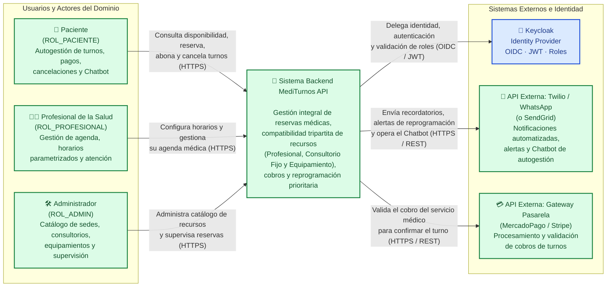
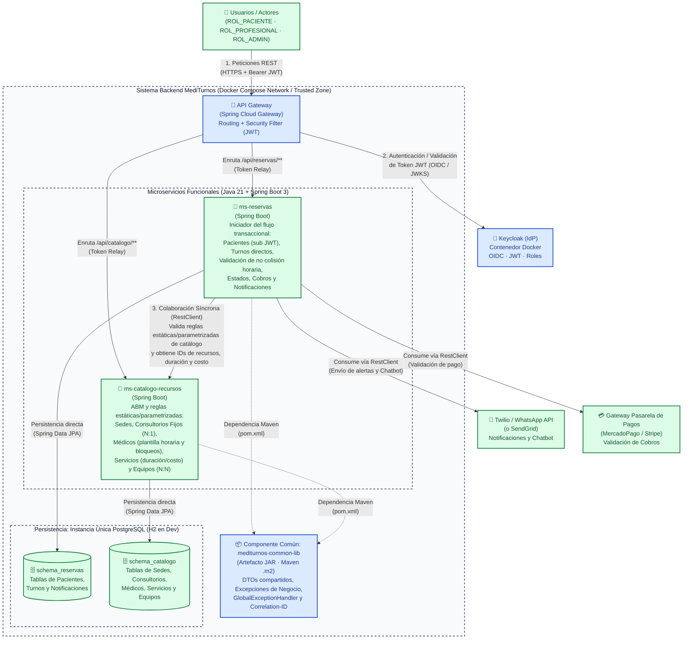

# 🏥 MediTurnos API — Sistema Integral de Gestión de Turnos y Recursos

> **Trabajo Práctico Integrador (TPI) — Backend de Aplicaciones (2026)**  
> Plataforma backend orientada a microservicios desarrollada con Java, Spring Boot, Spring Cloud Gateway, Keycloak y PostgreSQL.

---

## 📋 Índice

1. [Explicación del Dominio y Contexto del Problema](#-1-explicación-del-dominio-y-contexto-del-problema)
2. [Propuesta de Valor y Actores Involucrados](#-2-propuesta-de-valor-y-actores-involucrados)
3. [Procesos y Reglas de Negocio Clave](#-3-procesos-y-reglas-de-negocio-clave)
4. [Arquitectura y Matriz de Validación Técnica](#-4-arquitectura-y-matriz-de-validación-técnica)
5. [Diagramas de Arquitectura (Modelo C4)](#-5-diagramas-de-arquitectura-modelo-c4)
6. [Modelo de Datos — Diagrama Entidad-Relación (DER)](#-6-modelo-de-datos--diagrama-entidad-relación-der)
7. [Registro de Decisiones de Arquitectura (ADRs)](#-7-registro-de-decisiones-de-arquitectura-adrs)
8. [Stack Tecnológico](#-8-stack-tecnológico)
9. [Estructura del Proyecto y Despliegue](#-9-estructura-del-proyecto-y-despliegue)
10. [Hoja de Ruta y Pendientes](#-10-hoja-de-ruta-y-pendientes)

---

## 🩺 1. Explicación del Dominio y Contexto del Problema

En el sector de la salud privada e independiente, la gestión eficiente de turnos médicos, recursos físicos (consultorios asignados) y equipamiento de diagnóstico representa un desafío constante. Tradicionalmente, la falta de coordinación genera superposición de turnos y alta inasistencia.

El dominio abarca la **Gestión Integral de Reservas y Recursos**. El sistema opera como una plataforma backend orientada a microservicios diseñada deliberadamente para mantener una **baja complejidad operativa**. Su objetivo central es coordinar la agenda médica, validando la compatibilidad entre profesionales, consultorios fijos y equipamientos médicos, gestionando la validación de cobros e integrando interacciones automatizadas mediante notificaciones y Chatbot, todo ello soportado por un diseño modular y desacoplado.

> **Acotación de Alcance:**  
> Se excluye explícitamente el manejo de validaciones con Obras Sociales para acotar el alcance del dominio, operando de manera directa sobre los costos estipulados por cada servicio médico.

---

## 👥 2. Propuesta de Valor y Actores Involucrados

- **Pacientes (`ROL_PACIENTE`):** Autogestión 24/7 para consultar disponibilidad, reservar, abonar el turno, reprogramar o cancelar citas. Interactúan principalmente a través de notificaciones y un **Chatbot de WhatsApp** (utilizado para solicitar turnos y facilitar ayudas o consultas comunes al usuario). Además del inicio de sesión mediante Keycloak, cuentan con un endpoint para registrarse y dar de alta sus datos en el sistema (vinculados al identificador `sub` UUID del token JWT).
- **Profesionales de la Salud (`ROL_PROFESIONAL`):** Control unificado de agenda. Cada médico define sus **horarios de atención mediante valores parametrizados** (modificables a medida del profesional ante cualquier circunstancia), tiene asignado un **consultorio fijo** y cuenta con una serie de **tipos de servicios habilitados** (con sus respectivas duraciones y costos parametrizados).
- **Administradores (`ROL_ADMIN`):** Gestión del catálogo de sedes físicas, mantenimiento de consultorios y equipamientos de diagnóstico, y supervisión del estado general de las reservas.
- **Gestión de Identidades Externa (`Keycloak`):** La administración de identidades, almacenamiento seguro de credenciales y roles se delega en su totalidad al Identity Provider **Keycloak (OIDC + JWT)**, quitándole la carga de seguridad interna a la lógica de negocio del sistema.

---

## ⚙️ 3. Procesos y Reglas de Negocio Clave

El sistema no opera como un simple CRUD; incorpora lógica de dominio a través de las siguientes reglas core:

### 1. Disponibilidad Cruzada (Compatibilidad Tripartita) y Validación sin Acoplamiento Circular
Un turno solo puede reservarse si, para la fecha y franja horaria solicitada, se cumplen tanto las **validaciones estáticas/parametrizadas del catálogo** (`ms-catalogo-recursos`) como la **validación transaccional de no colisión horaria** (`ms-reservas`), evitando cualquier acoplamiento circular entre ambos microservicios:

1. **Validación Estática y Parametrizada en Catálogo (`ms-catalogo-recursos`):**
   - **Profesional y Servicio Habilitado:** El médico debe estar activo, estar **habilitado para brindar el tipo de servicio solicitado**, y el día/hora solicitado debe estar cubierto por su **plantilla horaria parametrizada** (sin bloqueos ni excepciones de agenda vigentes).
   - **Consultorio Fijo (`Relación N:1`):** Cada profesional tiene asignado un **consultorio fijo** (que puede ser compartido con otros profesionales en distintos horarios). El catálogo verifica que dicho consultorio se encuentre en estado **`OPERATIVO`**.
   - **Equipamiento de Diagnóstico (`Relación N:N`):** Los equipamientos se asocian a los servicios en relación muchos a muchos (`N:N`). El catálogo verifica que todos los equipamientos requeridos por el servicio estén en estado **`OPERATIVO`**.
   - **Coherencia de Sede Física:** Tanto el consultorio fijo del profesional como los equipamientos requeridos por el servicio deben pertenecer a la **misma Sede física**.
   - **Respuesta de Catálogo:** Si todas las reglas anteriores se cumplen, `ms-catalogo-recursos` retorna un DTO con: `duracionMinutos`, `costo`, `sedeId`, `consultorioFijoId` y la lista `List<equipamientoId>`.
2. **Validación Transaccional de No Colisión en Reservas (`ms-reservas`):**
   - Con los identificadores y la duración devueltos por el catálogo, `ms-reservas` calcula el rango `[horaInicio, horaFin)` y verifica transaccionalmente en su propio esquema (`schema_reservas`) que para esa fecha y franja horaria **no exista otro turno activo** que ocupe:
     - Al mismo **`profesionalId`**.
     - Al mismo **`consultorioId`** (evitando colisiones entre médicos que comparten consultorio fijo).
     - A ninguno de los **`equipamientoId`** de la `List<equipamientoId>` requerida por el servicio.
     - Al mismo **`pacienteId`** (evitando que un paciente reserve dos turnos superpuestos).

### 2. Transacción Directa y Atómica
Al momento de la reserva de un turno, **la operatoria es directa**:
- **NO se utilizan bloqueos temporales de celdas horarias (*"Hold States"*).**
- **NO se utilizan patrones asíncronos complejos como *Sagas* para este flujo.**
- Si el recurso está disponible en el instante de la transacción, el turno se genera e impacta **inmediatamente** en la base de datos.

### 3. Validación de Cobros (Pasarela de Pagos) y Estados Iniciales
El sistema se integra con un **Gateway Pasarela de Pagos externo (ej. MercadoPago / Stripe)** para la validación de cobros según el costo parametrizado del servicio:
- Si al registrar el turno el pago aún no impacta, el turno se persiste en estado **`RESERVADO`** hasta que se registra la transacción de cobro.
- Cuando se realiza y valida el pago a través de la pasarela, el turno pasa automáticamente al estado **`CONFIRMADO`**.

### 4. Regla de Cancelación y Reprogramación
- **Liberación Inmediata de Recursos (Cancelación de Paciente):** Cuando el paciente cancela su cita, el sistema disponibiliza inmediatamente el turno (liberando al profesional, al consultorio y al equipamiento) para su uso por otros pacientes.
- **Cancelación del Paciente sin Penalidad ($\ge 24\text{ hs}$):** El paciente puede cancelar su cita hasta 24 horas antes sin penalidad; el turno pasa al estado **`CANCELADO_PACIENTE`**.
- **Cancelación del Paciente con Penalidad ($< 24\text{ hs}$):** Si el paciente cancela con menos de 24 horas de anticipación, **se permite cancelar igualmente**, pero el turno queda registrado con estado **`CANCELADO_PENALIZADO`**, asentando la infracción/penalidad en el historial del paciente (sin involucrar lógica de devoluciones monetarias).
- **Cancelación de Bloque del Profesional, Bloqueo de Agenda y Reprogramación Prioritaria (Sin Doble Cobro):** Si el profesional cancela un bloque de atención para una fecha determinada:
  1. Se registra un **bloqueo/excepción de agenda** (o actualización de disponibilidad parametrizada) para ese profesional en la fecha y franja horaria afectada, impidiendo que otros pacientes reserven un turno nuevo con ese mismo médico en el horario en que avisó que no podrá asistir.
  2. Los turnos afectados pasan al estado **`PENDIENTE_REPROGRAMACION`** (liberando el consultorio fijo y los equipamientos para otros profesionales que los compartan) y el sistema envía automáticamente una notificación de alerta al paciente para que elija una nueva fecha de forma prioritaria.
  3. Al reprogramar dicho turno, se vuelve a validar la compatibilidad tripartita y la no colisión para el nuevo horario, pero **no se le cobra nuevamente al paciente**.

### 5. Resumen de Estados del Turno
- `RESERVADO`: Turno generado a la espera del impacto de la transacción de pago.
- `CONFIRMADO`: Turno con cobro validado por la pasarela de pagos.
- `CANCELADO_PACIENTE`: Cancelado por el paciente con $\ge 24\text{ hs}$ de anticipación (sin penalidad).
- `CANCELADO_PENALIZADO`: Cancelado por el paciente con $< 24\text{ hs}$ de anticipación (registra penalidad en su historial).
- `PENDIENTE_REPROGRAMACION`: Bloque cancelado por el profesional (con bloqueo de agenda para esa fecha); paciente notificado para elegir nueva fecha sin nuevo cobro.
- `ATENDIDO`: Atención médica efectivamente realizada.
- `AUSENTE`: El paciente no asistió a la cita ni canceló previamente.

---

## 🏗️ 4. Arquitectura y Matriz de Validación Técnica

| Criterio Evaluado (TPI) | Implementación Arquitectónica Propuesta |
| :--- | :--- |
| **División de Microservicios** | Se implementarán estrictamente **dos (2) microservicios funcionales (Spring Boot)** para minimizar la carga operativa:<br>1. **`ms-catalogo-recursos`**: Responsable del ABM y validación de reglas estáticas/parametrizadas del catálogo: sedes físicas, consultorios fijos (asignados en relación `N:1` a profesionales y con estado operativo), médicos (con plantillas horarias parametrizables, bloqueos/excepciones de agenda y servicios habilitados), especialidades, tipos de servicios (duraciones y costos) y equipamientos de diagnóstico (relación `N:N` con servicios y estado operativo).<br>2. **`ms-reservas`**: Responsable del registro de pacientes (vinculados al `sub` de Keycloak), orquestación del ciclo de vida transaccional directo del turno, **validación transaccional de no colisión horaria** sobre los turnos activos en `schema_reservas`, validación de cobros con la pasarela de pagos y coordinación de notificaciones. |
| **Diseño Interno de Capas** | Dentro de cada microservicio se aplicará un estricto patrón de capas (**`Controller -> Service -> Repository`**). Los controladores solo mapean DTOs y gestionan HTTP, delegando toda la lógica de negocio (como las validaciones cruzadas) a la capa `@Service`, la cual interactúa con las bases de datos a través de abstracciones de Spring Data JPA (`JpaRepository`). |
| **Colaboración entre Microservicios** | **Interacción Síncrona (`RestClient`) sin Acoplamiento Circular:**<br>1. Cuando un paciente solicita agendar un turno en `ms-reservas` (iniciador del flujo), este consulta vía `RestClient` a `ms-catalogo-recursos` enviando `(profesionalId, servicioId, fecha, horaInicio)`.<br>2. `ms-catalogo-recursos` valida las **reglas estáticas y parametrizadas del catálogo**: que el médico esté activo, habilitado para ese servicio, con plantilla horaria semanal vigente para ese día/hora y sin bloqueos puntuales en `BLOQUEOS_PROFESIONAL` para esa fecha, y que su consultorio fijo y los equipamientos requeridos estén en estado `OPERATIVO` y en la **misma Sede**. Si todo es válido, devuelve (`200 OK`) un DTO con: `duracionMinutos`, `costo`, `sedeId`, `consultorioFijoId` y `List<equipamientoId>`.<br>3. Con esos IDs, `ms-reservas` ejecuta la **validación transaccional de no colisión** en su propio `schema_reservas`: verifica en su tabla de turnos que para esa fecha y rango `[horaInicio, horaFin)` no exista otro turno activo que ocupe al mismo `profesionalId`, al mismo `consultorioId`, a ninguno de los `equipamientoId`, ni al mismo `pacienteId`, persistiendo el turno directamente. |
| **APIs Públicas Externas** | 1. **Notificaciones y Chatbot (API Externa Principal):** Se integrará la API de **Twilio / WhatsApp Business (o SendGrid)** para el envío de notificaciones (confirmaciones, alertas de reprogramación prioritaria y recordatorios) y dar soporte al Chatbot de WhatsApp (solicitud de turnos y ayudas frecuentes al usuario).<br>2. **Gateway Pasarela de Pagos:** Servicio externo de procesamiento de pagos (**ej. MercadoPago / Stripe**) para la validación de cobros de los turnos.<br>*(Nota: Queda como opcional/adicional otra API externa de cálculo de distancias solo si alcanza el tiempo).* |
| **Seguridad y Enrutamiento** | Se utilizará **Spring Cloud Gateway** como punto único de entrada al backend. Este Gateway implementará un **Security Filter** que delegará la autenticación en **Keycloak**. Los microservicios solo aceptarán peticiones enrutadas desde el Gateway con tokens JWT válidos. |
| **Componente Común (JAR Reutilizable)** | Se desarrollará un artefacto Maven independiente (**`mediturnos-common-lib.jar`**) con los elementos transversales del sistema: **DTOs compartidos** (contratos para la comunicación entre `ms-reservas` y `ms-catalogo-recursos`), **Excepciones Personalizadas de Negocio** (ej. `ExcepcionDeNegocio`, `RecursoNoDisponibleException`), el **manejo centralizado de excepciones** (`GlobalExceptionHandler`) y el filtro/utilidades para la propagación del **`Correlation-ID`** para trazabilidad de logs entre ambos microservicios.<br>**Integración:** Será instalado en el repositorio local `.m2` mediante `mvn clean install` e inyectado como `<dependency>` en ambos microservicios. |
| **Persistencia de Datos (Base de Datos)** | Se utilizará una única instancia de base de datos compartida (**H2 embebida** para desarrollo rápido, escalable a **PostgreSQL contenedorizado** para el despliegue final). Para garantizar el desacoplamiento, se aplicará una división lógica mediante esquemas independientes (**`schema_catalogo`** y **`schema_reservas`**), asegurando que ningún microservicio acceda directamente a las tablas del otro. |
| **Documentación y Despliegue** | Cada microservicio expondrá sus contratos dinámicamente mediante **Swagger UI / OpenAPI 3**. El despliegue integral (Gateway, microservicios, PostgreSQL y Keycloak) se orquestará localmente mediante **Docker Compose**. |

---

## 📐 5. Diagramas de Arquitectura (Modelo C4)

Siguiendo la propuesta de **Simon Brown (C4 Model)** y los lineamientos de la cátedra, se presentan los diagramas de **Contexto (C1)** y de **Contenedores (C2)**.

En ambos diagramas se respeta la convención de colores del enunciado:
- 🟦 **Azul (Restricción del TPI):** Componentes, integraciones o capacidades exigidas como requisito por la cátedra.
- 🟩 **Verde (Decisión del Equipo):** Responsabilidades funcionales, reglas de dominio, división de servicios e integraciones concretas definidas por el equipo para **MediTurnos API**.

---

### 5.1. C1 — Diagrama de Contexto del Sistema

En este primer nivel se observa a **MediTurnos API** como una caja negra en el centro, identificando qué actores lo utilizan y con qué sistemas externos interactúa para cumplir los procesos del negocio.



#### Elementos clave del C1:
- **Quiénes interactúan:** Los tres perfiles definidos (`ROL_PACIENTE`, `ROL_PROFESIONAL` y `ROL_ADMIN`), cada uno con responsabilidades diferenciadas.
- **Identidad delegada:** **Keycloak** centraliza la autenticación mediante OpenID Connect (OIDC) y emite los tokens JWT con los roles correspondientes.
- **Integraciones Externas de Negocio:**
  1. **Twilio / WhatsApp Business (o SendGrid):** Permite notificar confirmaciones, disparar el aviso de reprogramación prioritaria ante cancelaciones médicas y asistir al paciente mediante el Chatbot.
  2. **Gateway Pasarela de Pagos (MercadoPago / Stripe):** Valida la transacción de cobro para que el turno pase de estado `RESERVADO` a `CONFIRMADO`.

---

### 5.2. C2 — Diagrama de Contenedores

En este segundo nivel se hace *zoom* dentro del límite del **Sistema Backend MediTurnos**, detallando el **API Gateway**, los **dos microservicios funcionales**, el **artefacto Maven reutilizable (`JAR`)**, la **estrategia de persistencia por esquemas** y las comunicaciones internas/externas.



#### Lectura Arquitectónica del C2:
1. **Punto Único de Entrada y *Trusted Zone*:** Todo el tráfico externo ingresa exclusivamente por el **API Gateway**, el cual valida el token JWT contra **Keycloak** mediante su *Security Filter* antes de enrutar las peticiones hacia `ms-reservas` o `ms-catalogo-recursos`.
2. **Colaboración Funcional Real (Sin Acoplamiento Circular):** Al solicitar un turno en `ms-reservas` (iniciador), este se comunica síncronamente vía `RestClient` con `ms-catalogo-recursos` enviando `(profesionalId, servicioId, fecha, horaInicio)`. El catálogo valida las reglas estáticas y parametrizadas (médico activo con plantilla horaria semanal vigente y sin bloqueos para esa fecha, servicio habilitado, consultorio fijo y equipamientos `N:N` en estado `OPERATIVO` y en la misma sede) y retorna un DTO con `duracionMinutos`, `costo`, `sedeId`, `consultorioFijoId` y `List<equipamientoId>`. Con esos IDs, `ms-reservas` ejecuta la validación transaccional de no colisión horaria en su propio `schema_reservas` para el rango `[horaInicio, horaFin)`.
3. **Reutilización mediante `mediturnos-common-lib.jar`:** Ambos microservicios inyectan en su `pom.xml` el artefacto JAR instalado en `.m2`, compartiendo los DTOs de contrato inter-servicio, las Excepciones Personalizadas de Negocio (`ExcepcionDeNegocio`, `RecursoNoDisponibleException`), el `GlobalExceptionHandler` y la propagación del `Correlation-ID` para trazabilidad de logs.
4. **Aislamiento Lógico de Datos:** Aunque se utiliza un único contenedor **PostgreSQL**, `ms-reservas` opera exclusivamente sobre `schema_reservas` y `ms-catalogo-recursos` sobre `schema_catalogo`, sin cruzar consultas SQL entre sí.

---

## 🗄️ 6. Modelo de Datos — Diagrama Entidad-Relación (DER)

Siguiendo la regla práctica de JPA de la cátedra (priorizar entidades claras, relaciones `N:1` bien definidas y tablas intermedias explícitas con clave subrogada para relaciones `N:N`) y respetando el **ADR 001** (dos esquemas separados sin `FOREIGN KEY` cruzadas entre ellos), se presenta el diseño relacional completo de ambos esquemas.

### Decisiones Clave Plasmadas en el DER:
1. **Resolución de Colisiones sin Cruzar Esquemas:** En `schema_reservas`, la tabla `TURNOS` almacena el *snapshot* de IDs lógicos (`profesional_id`, `consultorio_id`, `sede_id`) y se acompaña de `TURNO_EQUIPAMIENTOS` (`turno_id`, `equipamiento_id`). Así, `ms-reservas` verifica colisiones de profesionales, consultorios compartidos (`N:1`), equipamientos (`N:N`) y pacientes consultando únicamente su propio esquema en el rango `[hora_inicio, hora_fin)` para turnos en estado `RESERVADO` o `CONFIRMADO`.
2. **Separación de Plantilla Semanal y Bloqueos Puntuales (`HORARIOS_PROFESIONAL` vs `BLOQUEOS_PROFESIONAL`):** `HORARIOS_PROFESIONAL` modela la agenda semanal recurrente (`LUNES..DOMINGO`), mientras que `BLOQUEOS_PROFESIONAL` registra ausencias o cancelaciones de bloques en una `fecha` específica sin desactivar el resto de las semanas del año.
3. **Claves Subrogadas y Unicidad Compuesta en Tablas Intermedias `N:N`:** Las tablas `PROFESIONAL_SERVICIOS`, `SERVICIO_EQUIPAMIENTOS` y `TURNO_EQUIPAMIENTOS` utilizan `bigint id PK` junto con restricciones `UK` compuestas, evitando la complejidad de clases `@EmbeddedId` en JPA y previniendo duplicados por base de datos.
4. **Control del "Sin Doble Cobro" y Trazabilidad:** En `TURNOS`, el atributo `costo_acordado` actúa como *snapshot* histórico ante futuros cambios de precios en catálogo, y el booleano `pagado` (junto al historial `1:N` en `PAGOS` y `fecha_actualizacion`) permite que un turno en estado `PENDIENTE_REPROGRAMACION` conserve su condición de abonado al asignarle una nueva fecha y hora.
5. **Coherencia de Sede Física y Flexibilidad del Chatbot:** Tanto `CONSULTORIOS` como `EQUIPAMIENTOS` poseen clave foránea hacia `SEDES` (`sede_id`), permitiendo a `ms-catalogo-recursos` comprobar que pertenecen al mismo edificio. En `NOTIFICACIONES`, `turno_id` es opcional (`NULLABLE`) para soportar interacciones generales del Chatbot de WhatsApp previas a la creación de un turno.

```mermaid
erDiagram
    %% ==========================================================
    %% ESQUEMA 1: schema_catalogo (Microservicio ms-catalogo-recursos)
    %% ==========================================================

    SEDES {
        bigint id PK
        varchar nombre UK "NOT NULL"
        varchar direccion "NOT NULL"
        varchar telefono
        boolean activa "NOT NULL DEFAULT TRUE"
    }

    CONSULTORIOS {
        bigint id PK
        bigint sede_id FK "NOT NULL, UK_compuesta (Coherencia de Sede)"
        varchar codigo_nombre "NOT NULL, UK_compuesta (Ej: Box 101)"
        boolean operativo "NOT NULL DEFAULT TRUE (Mantenimiento)"
    }

    ESPECIALIDADES {
        bigint id PK
        varchar nombre UK "NOT NULL"
        varchar descripcion
        boolean activa "NOT NULL DEFAULT TRUE"
    }

    PROFESIONALES {
        bigint id PK
        varchar keycloak_sub UK "NOT NULL (UUID Token JWT)"
        bigint especialidad_id FK "NOT NULL"
        bigint consultorio_fijo_id FK "NOT NULL (Relacion N:1)"
        varchar matricula UK "NOT NULL"
        varchar nombre "NOT NULL"
        varchar apellido "NOT NULL"
        varchar email UK "NOT NULL"
        boolean activo "NOT NULL DEFAULT TRUE"
    }

    HORARIOS_PROFESIONAL {
        bigint id PK
        bigint profesional_id FK "NOT NULL"
        varchar dia_semana "NOT NULL (LUNES..DOMINGO)"
        time hora_inicio "NOT NULL"
        time hora_fin "NOT NULL"
        boolean activo "NOT NULL DEFAULT TRUE"
    }

    BLOQUEOS_PROFESIONAL {
        bigint id PK
        bigint profesional_id FK "NOT NULL"
        date fecha "NOT NULL (Bloqueo puntual por fecha)"
        time hora_inicio "NOT NULL"
        time hora_fin "NOT NULL"
        varchar motivo "Ej: Congreso, Ausencia medica"
    }

    SERVICIOS {
        bigint id PK
        bigint especialidad_id FK "NOT NULL"
        varchar nombre "NOT NULL"
        varchar descripcion
        int duracion_minutos "NOT NULL (Parametrizado)"
        decimal costo "NOT NULL (Parametrizado, precision 10,2)"
        boolean activo "NOT NULL DEFAULT TRUE"
    }

    PROFESIONAL_SERVICIOS {
        bigint id PK "Evita @EmbeddedId en JPA"
        bigint profesional_id FK "NOT NULL, UK_compuesta"
        bigint servicio_id FK "NOT NULL, UK_compuesta"
    }

    EQUIPAMIENTOS {
        bigint id PK
        bigint sede_id FK "NOT NULL (Coherencia de Sede)"
        varchar nombre "NOT NULL"
        varchar codigo_inventario UK "NOT NULL"
        boolean operativo "NOT NULL DEFAULT TRUE (Mantenimiento)"
    }

    SERVICIO_EQUIPAMIENTOS {
        bigint id PK "Evita @EmbeddedId en JPA"
        bigint servicio_id FK "NOT NULL, UK_compuesta"
        bigint equipamiento_id FK "NOT NULL, UK_compuesta"
    }

    %% Relaciones internas de schema_catalogo
    SEDES ||--o{ CONSULTORIOS : "posee"
    SEDES ||--o{ EQUIPAMIENTOS : "aloja"
    CONSULTORIOS ||--o{ PROFESIONALES : "asignado fijo a (N:1)"
    ESPECIALIDADES ||--o{ PROFESIONALES : "agrupa"
    ESPECIALIDADES ||--o{ SERVICIOS : "categoriza"
    PROFESIONALES ||--o{ HORARIOS_PROFESIONAL : "parametriza plantilla semanal"
    PROFESIONALES ||--o{ BLOQUEOS_PROFESIONAL : "registra excepcion/bloqueo"
    PROFESIONALES ||--o{ PROFESIONAL_SERVICIOS : "habilitado para"
    SERVICIOS ||--o{ PROFESIONAL_SERVICIOS : "brindado por"
    SERVICIOS ||--o{ SERVICIO_EQUIPAMIENTOS : "requiere (N:N)"
    EQUIPAMIENTOS ||--o{ SERVICIO_EQUIPAMIENTOS : "utilizado en (N:N)"

    %% ==========================================================
    %% ESQUEMA 2: schema_reservas (Microservicio ms-reservas)
    %% Sin FKs fisicas hacia schema_catalogo (Bajo Acoplamiento)
    %% ==========================================================

    PACIENTES {
        bigint id PK
        varchar keycloak_sub UK "NOT NULL (UUID Token JWT)"
        varchar dni UK "NOT NULL"
        varchar nombre "NOT NULL"
        varchar apellido "NOT NULL"
        varchar email UK "NOT NULL"
        varchar telefono_whatsapp "NOT NULL (Chatbot / Alertas)"
        int cantidad_penalizaciones "NOT NULL DEFAULT 0 (Cancelaciones < 24hs)"
        boolean activo "NOT NULL DEFAULT TRUE"
        timestamp fecha_alta "NOT NULL"
    }

    TURNOS {
        bigint id PK
        bigint paciente_id FK "NOT NULL"
        bigint profesional_id "NOT NULL (ID logico de catalogo)"
        bigint servicio_id "NOT NULL (ID logico de catalogo)"
        bigint consultorio_id "NOT NULL (ID logico para validar colision N:1)"
        bigint sede_id "NOT NULL (ID logico de catalogo)"
        date fecha "NOT NULL"
        time hora_inicio "NOT NULL"
        time hora_fin "NOT NULL (hora_inicio + duracion_minutos)"
        decimal costo_acordado "NOT NULL (Snapshot del costo, precision 10,2)"
        varchar estado "NOT NULL (RESERVADO, CONFIRMADO, etc.)"
        boolean pagado "NOT NULL DEFAULT FALSE (Evita doble cobro)"
        timestamp fecha_creacion "NOT NULL"
        timestamp fecha_actualizacion "Trazabilidad de reprogramacion/cambio"
    }

    TURNO_EQUIPAMIENTOS {
        bigint id PK
        bigint turno_id FK "NOT NULL, UK_compuesta"
        bigint equipamiento_id "NOT NULL, UK_compuesta (ID logico colision N:N)"
    }

    PAGOS {
        bigint id PK
        bigint turno_id FK "NOT NULL"
        varchar transaccion_externa_id UK "ID MercadoPago / Stripe"
        varchar pasarela "NOT NULL"
        decimal monto "NOT NULL (precision 10,2)"
        varchar estado_pago "NOT NULL (PENDIENTE, APROBADO, RECHAZADO)"
        timestamp fecha_pago
    }

    NOTIFICACIONES {
        bigint id PK
        bigint turno_id FK "NULLABLE (Opcional en interacciones de Chatbot)"
        bigint paciente_id FK "NOT NULL"
        varchar canal "NOT NULL (WHATSAPP, EMAIL)"
        varchar destinatario "NOT NULL (Snapshot telefono/email)"
        varchar tipo_alerta "NOT NULL (CONFIRMACION, REPROGRAMACION, etc.)"
        varchar estado_envio "NOT NULL (ENVIADO, ERROR)"
        varchar detalle_mensaje "Texto enviado o motivo de error"
        timestamp fecha_envio "NOT NULL"
    }

    %% Relaciones internas de schema_reservas
    PACIENTES ||--o{ TURNOS : "solicita"
    TURNOS ||--o{ TURNO_EQUIPAMIENTOS : "bloquea en franja horaria"
    TURNOS ||--o{ PAGOS : "registra cobro"
    TURNOS o|--o{ NOTIFICACIONES : "dispara"
    PACIENTES ||--o{ NOTIFICACIONES : "recibe"
```



---

## 📑 7. Registro de Decisiones de Arquitectura (ADRs)

### ADR 001: Adopción de "Única BD con División Lógica por Esquemas"
- **Contexto:** El patrón estricto de *"Database-per-Service"* requiere levantar múltiples motores de bases de datos, lo cual multiplica los costos de infraestructura, consumo de RAM y complejidad de despliegue, siendo excesivo para las necesidades del proyecto actual.
- **Decisión:** Se levanta un único motor de base de datos relacional (PostgreSQL). Sin embargo, cada microservicio operará de forma aislada sobre su propio esquema lógico protegido (`schema_catalogo` y `schema_reservas`). No habrá `Joins` ni consultas SQL directas entre dominios. Toda sincronización de información entre esquemas deberá hacerse sí o sí a través de las llamadas API (`RestClient`) entre los microservicios.
- **Consecuencias:** Se optimiza radicalmente el uso de recursos y se facilita el desarrollo local, pero se mantiene la cohesión lógica y se cumple con la restricción académica de bajo acoplamiento de datos exigida por la cátedra.

### ADR 002: Modelo de Comunicación Síncrona vs Asíncrona
- **Contexto:** Al reservar un turno, `ms-reservas` necesita validar las reglas estáticas/parametrizadas del catálogo y obtener los identificadores de recursos (`sedeId`, `consultorioFijoId`, `List<equipamientoId>`), la duración y el costo que residen en `ms-catalogo-recursos` para luego ejecutar la validación transaccional de no colisión en `schema_reservas`.
- **Decisión:** Se opta por una comunicación síncrona vía HTTP (`RestClient`) en lugar de replicar datos asíncronamente mediante colas de mensajería (RabbitMQ/Kafka), manteniendo una transacción directa y atómica sin bloqueos temporales (*Hold States*) ni *Sagas*.
- **Consecuencias:** Simplifica enormemente la topología de la red y el manejo de transacciones, a expensas de un ligero aumento en la latencia al momento de agendar. Se implementarán tiempos de espera (*timeouts*) defensivos para evitar que una caída en catálogo bloquee el pool de conexiones de reservas.

---

## 🛠️ 8. Stack Tecnológico

- **Lenguaje y Framework:** Java 21 + Spring Boot 3.x
- **Enrutamiento:** Spring Cloud Gateway (Routing + Security Filter)
- **Identidad y Seguridad:** Keycloak (OIDC · JWT · Roles) + Spring Security
- **Persistencia:** Spring Data JPA + H2 (Desarrollo) / PostgreSQL (Despliegue final)
- **Comunicación Inter-Servicio e Integraciones:** Spring `RestClient`
- **Servicios Externos:**
  - Twilio / WhatsApp Business API (o SendGrid) — Notificaciones y Chatbot de autogestión
  - Gateway Pasarela de Pagos (MercadoPago / Stripe) — Validación de cobros
- **Documentación API:** OpenAPI 3 / Swagger UI
- **Construcción y Empaquetado:** Apache Maven (`mediturnos-common-lib.jar` en `.m2`)
- **Contenerización:** Docker & Docker Compose

---

## 📂 9. Estructura del Proyecto y Despliegue

```text
MediTurnos/
├── docs/                        # Documentación de dominio, diagramas C4, DER y Diagrama de Clases
├── mediturnos-common-lib/       # Componente común Maven (.jar): DTOs, Excepciones de Negocio, GlobalExceptionHandler y Correlation-ID
├── api-gateway/                 # Spring Cloud Gateway + Security Filter
├── ms-catalogo-recursos/        # Microservicio de catálogo (sedes, consultorios, médicos, servicios, equipamientos N:N)
├── ms-reservas/                 # Microservicio de reservas (turnos directos, pacientes, cobros y notificaciones)
├── docker-compose.yml           # Despliegue integral (Gateway, Microservicios, PostgreSQL y Keycloak)
└── README.md                    # Documentación general para la cátedra
```

---

## 📌 10. Hoja de Ruta y Pendientes

- [x] Definición y validación del dominio, actores, reglas de negocio y ADRs.
- [x] Elaboración de **Diagrama de Contexto (C1)** y **Diagrama de Contenedores (C2)** (Modelo C4).
- [x] Elaboración del **Diagrama Entidad-Relación (DER)** de la base de datos (`schema_catalogo` y `schema_reservas`).
- [ ] Elaboración del **Diagrama de Clases** de ambos microservicios *(siguiente etapa)*.
- [ ] Implementación de `mediturnos-common-lib`, microservicios, Gateway y configuración de Docker Compose.
