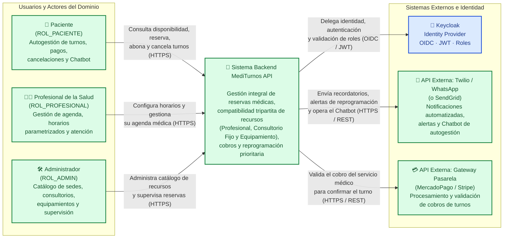
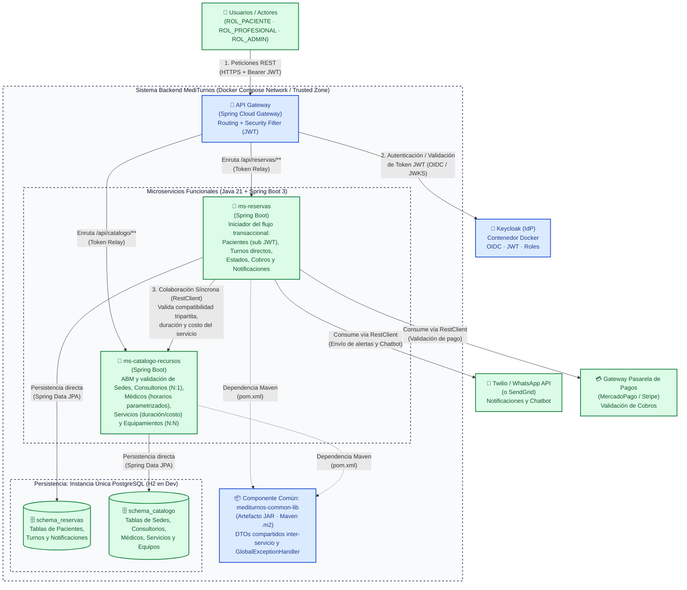

# 🏥 MediTurnos API — Sistema Integral de Gestión de Turnos y Recursos

> **Trabajo Práctico Integrador (TPI) — Backend de Aplicaciones (2026)**  
> Plataforma backend orientada a microservicios desarrollada con Java, Spring Boot, Spring Cloud Gateway, Keycloak y PostgreSQL.

---

## 📋 Índice

1. [Explicación del Dominio y Contexto del Problema](#-1-explicación-del-dominio-y-contexto-del-problema)
2. [Propuesta de Valor y Actores Involucrados](#-2-propuesta-de-valor-y-actores-involucrados)
3. [Procesos y Reglas de Negocio Clave](#-3-procesos-y-reglas-de-negocio-clave)
4. [Arquitectura y Matriz de Validación Técnica](#-4-arquitectura-y-matriz-de-validación-técnica)
5. [Diagramas de Arquitectura (Modelo C4)](#-5-diagramas-de-arquitectura-modelo-c4)
6. [Registro de Decisiones de Arquitectura (ADRs)](#-6-registro-de-decisiones-de-arquitectura-adrs)
7. [Stack Tecnológico](#-7-stack-tecnológico)
8. [Estructura del Proyecto y Despliegue](#-8-estructura-del-proyecto-y-despliegue)
9. [Hoja de Ruta y Pendientes](#-9-hoja-de-ruta-y-pendientes)

---

## 🩺 1. Explicación del Dominio y Contexto del Problema

En el sector de la salud privada e independiente, la gestión eficiente de turnos médicos, recursos físicos (consultorios asignados) y equipamiento de diagnóstico representa un desafío constante. Tradicionalmente, la falta de coordinación genera superposición de turnos y alta inasistencia.

El dominio abarca la **Gestión Integral de Reservas y Recursos**. El sistema opera como una plataforma backend orientada a microservicios diseñada deliberadamente para mantener una **baja complejidad operativa**. Su objetivo central es coordinar la agenda médica, validando la compatibilidad entre profesionales, consultorios fijos y equipamientos médicos, gestionando la validación de cobros e integrando interacciones automatizadas mediante notificaciones y Chatbot, todo ello soportado por un diseño modular y desacoplado.

> **Acotación de Alcance:**  
> Se excluye explícitamente el manejo de validaciones con Obras Sociales para acotar el alcance del dominio, operando de manera directa sobre los costos estipulados por cada servicio médico.

---

## 👥 2. Propuesta de Valor y Actores Involucrados

- **Pacientes (`ROL_PACIENTE`):** Autogestión 24/7 para consultar disponibilidad, reservar, abonar el turno, reprogramar o cancelar citas. Interactúan principalmente a través de notificaciones y un **Chatbot de WhatsApp** (utilizado para solicitar turnos y facilitar ayudas o consultas comunes al usuario). Además del inicio de sesión mediante Keycloak, cuentan con un endpoint para registrarse y dar de alta sus datos en el sistema (vinculados al identificador `sub` UUID del token JWT).
- **Profesionales de la Salud (`ROL_PROFESIONAL`):** Control unificado de agenda. Cada médico define sus **horarios de atención mediante valores parametrizados** (modificables a medida del profesional ante cualquier circunstancia), tiene asignado un **consultorio fijo** y cuenta con una serie de **tipos de servicios habilitados** (con sus respectivas duraciones y costos parametrizados).
- **Administradores (`ROL_ADMIN`):** Gestión del catálogo de sedes físicas, mantenimiento de consultorios y equipamientos de diagnóstico, y supervisión del estado general de las reservas.
- **Gestión de Identidades Externa (`Keycloak`):** La administración de identidades, almacenamiento seguro de credenciales y roles se delega en su totalidad al Identity Provider **Keycloak (OIDC + JWT)**, quitándole la carga de seguridad interna a la lógica de negocio del sistema.

---

## ⚙️ 3. Procesos y Reglas de Negocio Clave

El sistema no opera como un simple CRUD; incorpora lógica de dominio a través de las siguientes reglas core:

### 1. Disponibilidad Cruzada (Compatibilidad Tripartita)
Un turno solo puede reservarse si, para la franja horaria solicitada, existe disponibilidad simultánea de las **tres partes involucradas (Profesional + Consultorio + Equipamiento)** y se cumplen las validaciones de coherencia del catálogo:

1. **Disponibilidad del Profesional y Servicio Habilitado:**
   - El médico debe estar activo, el horario solicitado debe encontrarse dentro de su **horario de atención parametrizado**, y no debe poseer otro turno activo en esa misma franja horaria.
   - El profesional debe estar **habilitado para brindar el tipo de servicio solicitado** (cada profesional tiene asignada la serie de servicios que puede realizar).
   - La **duración del turno** y su **costo** se determinan de forma parametrizada según el tipo de servicio elegido.
2. **Disponibilidad del Consultorio Fijo (`Relación N:1`):**
   - Cada profesional tiene asignado un **consultorio fijo**, lo que agiliza la determinación del espacio físico sin tener que buscar aulas o salas al azar.
   - Sin embargo, **un mismo consultorio puede estar asignado a varios profesionales**. Por lo tanto, el sistema valida que el consultorio esté operativo y que no se encuentre ocupado en esa misma franja horaria por otro profesional que comparta dicho consultorio.
3. **Disponibilidad del Equipamiento de Diagnóstico (`Relación N:N`):**
   - Los equipamientos están asociados a los servicios en una relación muchos a muchos (`N:N`): un equipamiento puede estar asociado a varios servicios y un servicio puede requerir varios equipamientos o ninguno.
   - El sistema verifica en el catálogo que todos los equipamientos requeridos por el servicio estén operativos y libres de colisión en la franja horaria solicitada.
4. **Coherencia de Sede Física:**
   - Tanto el consultorio fijo del profesional como los equipamientos requeridos por el servicio deben pertenecer a la **misma Sede física**.
5. **No Superposición del Paciente:**
   - Un mismo paciente no puede reservar dos turnos distintos que se solapen en el mismo día y rango horario.

### 2. Transacción Directa y Atómica
Al momento de la reserva de un turno, **la operatoria es directa**:
- **NO se utilizan bloqueos temporales de celdas horarias (*"Hold States"*).**
- **NO se utilizan patrones asíncronos complejos como *Sagas* para este flujo.**
- Si el recurso está disponible en el instante de la transacción, el turno se genera e impacta **inmediatamente** en la base de datos.

### 3. Validación de Cobros (Pasarela de Pagos) y Estados Iniciales
El sistema se integra con un **Gateway Pasarela de Pagos externo (ej. MercadoPago / Stripe)** para la validación de cobros según el costo parametrizado del servicio:
- Si al registrar el turno el pago aún no impacta, el turno se persiste en estado **`RESERVADO`** hasta que se registra la transacción de cobro.
- Cuando se realiza y valida el pago a través de la pasarela, el turno pasa automáticamente al estado **`CONFIRMADO`**.

### 4. Regla de Cancelación y Reprogramación
- **Liberación Inmediata de Recursos:** En cualquier caso de cancelación, el sistema disponibiliza inmediatamente el turno (liberando al profesional, al consultorio y al equipamiento) para su uso por otros pacientes.
- **Cancelación del Paciente sin Penalidad ($\ge 24\text{ hs}$):** El paciente puede cancelar su cita hasta 24 horas antes sin penalidad; el turno pasa al estado **`CANCELADO_PACIENTE`**.
- **Cancelación del Paciente con Penalidad ($< 24\text{ hs}$):** Si el paciente cancela con menos de 24 horas de anticipación, **se permite cancelar igualmente**, pero el turno queda registrado con estado **`CANCELADO_PENALIZADO`**, asentando la infracción/penalidad en el historial del paciente (sin involucrar lógica de devoluciones monetarias).
- **Cancelación del Profesional y Reprogramación Prioritaria (Sin Doble Cobro):** Si el profesional cancela un bloque de atención, los turnos afectados pasan al estado **`PENDIENTE_REPROGRAMACION`** y el sistema envía automáticamente una notificación de alerta al paciente para que elija una nueva fecha de forma prioritaria. Al reprogramar dicho turno, se vuelve a validar la compatibilidad tripartita para el nuevo horario pero **no se le cobra nuevamente al paciente**.

### 5. Resumen de Estados del Turno
- `RESERVADO`: Turno generado a la espera del impacto de la transacción de pago.
- `CONFIRMADO`: Turno con cobro validado por la pasarela de pagos.
- `CANCELADO_PACIENTE`: Cancelado por el paciente con $\ge 24\text{ hs}$ de anticipación (sin penalidad).
- `CANCELADO_PENALIZADO`: Cancelado por el paciente con $< 24\text{ hs}$ de anticipación (registra penalidad en su historial).
- `PENDIENTE_REPROGRAMACION`: Bloque cancelado por el profesional; paciente notificado para elegir nueva fecha sin nuevo cobro.
- `ATENDIDO`: Atención médica efectivamente realizada.
- `AUSENTE`: El paciente no asistió a la cita ni canceló previamente.

---

## 🏗️ 4. Arquitectura y Matriz de Validación Técnica

| Criterio Evaluado (TPI) | Implementación Arquitectónica Propuesta |
| :--- | :--- |
| **División de Microservicios** | Se implementarán estrictamente **dos (2) microservicios funcionales (Spring Boot)** para minimizar la carga operativa:<br>1. **`ms-catalogo-recursos`**: Responsable del ABM y catálogo de sedes físicas, consultorios (asignados en relación `N:1` a profesionales), médicos (con horarios parametrizables y servicios habilitados), especialidades, tipos de servicios (duraciones y costos) y equipamientos de diagnóstico (relación `N:N` con servicios y validación de disponibilidad).<br>2. **`ms-reservas`**: Responsable del registro de pacientes (vinculados al `sub` de Keycloak), orquestación del ciclo de vida transaccional directo del turno, validación de cobros con la pasarela de pagos y coordinación de notificaciones. |
| **Diseño Interno de Capas** | Dentro de cada microservicio se aplicará un estricto patrón de capas (**`Controller -> Service -> Repository`**). Los controladores solo mapean DTOs y gestionan HTTP, delegando toda la lógica de negocio (como las validaciones cruzadas) a la capa `@Service`, la cual interactúa con las bases de datos a través de abstracciones de Spring Data JPA (`JpaRepository`). |
| **Colaboración entre Microservicios** | **Interacción Síncrona (`RestClient`):** Cuando un paciente intenta agendar un turno en `ms-reservas` (iniciador del flujo), este servicio realiza una petición síncrona mediante `RestClient` a `ms-catalogo-recursos`. Solicita validar la compatibilidad de recursos en catálogo (que el médico esté activo y habilitado para ese servicio en ese horario, que el consultorio y el equipamiento en la misma sede estén disponibles) y recuperar la duración y el costo del servicio. Solo con la respuesta favorable (`200 OK`) de catálogo, `ms-reservas` persiste la transacción directamente. |
| **APIs Públicas Externas** | 1. **Notificaciones y Chatbot (API Externa Principal):** Se integrará la API de **Twilio / WhatsApp Business (o SendGrid)** para el envío de notificaciones (confirmaciones, alertas de reprogramación prioritaria y recordatorios) y dar soporte al Chatbot de WhatsApp (solicitud de turnos y ayudas frecuentes al usuario).<br>2. **Gateway Pasarela de Pagos:** Servicio externo de procesamiento de pagos (**ej. MercadoPago / Stripe**) para la validación de cobros de los turnos.<br>*(Nota: Queda como opcional/adicional otra API externa de cálculo de distancias solo si alcanza el tiempo).* |
| **Seguridad y Enrutamiento** | Se utilizará **Spring Cloud Gateway** como punto único de entrada al backend. Este Gateway implementará un **Security Filter** que delegará la autenticación en **Keycloak**. Los microservicios solo aceptarán peticiones enrutadas desde el Gateway con tokens JWT válidos. |
| **Componente Común (JAR Reutilizable)** | Se desarrollará un artefacto Maven independiente (**`mediturnos-common-lib.jar`**) mantenido lo más simple posible. Contendrá únicamente los **DTOs compartidos** (para la comunicación entre `ms-reservas` y `ms-catalogo-recursos`) y el **manejo centralizado de excepciones** (`GlobalExceptionHandler`).<br>**Integración:** Será instalado en el repositorio local `.m2` mediante `mvn clean install` e inyectado como `<dependency>` en ambos microservicios. |
| **Persistencia de Datos (Base de Datos)** | Se utilizará una única instancia de base de datos compartida (**H2 embebida** para desarrollo rápido, escalable a **PostgreSQL contenedorizado** para el despliegue final). Para garantizar el desacoplamiento, se aplicará una división lógica mediante esquemas independientes (**`schema_catalogo`** y **`schema_reservas`**), asegurando que ningún microservicio acceda directamente a las tablas del otro. |
| **Documentación y Despliegue** | Cada microservicio expondrá sus contratos dinámicamente mediante **Swagger UI / OpenAPI 3**. El despliegue integral (Gateway, microservicios, PostgreSQL y Keycloak) se orquestará localmente mediante **Docker Compose**. |

---

## 📐 5. Diagramas de Arquitectura (Modelo C4)

Siguiendo la propuesta de **Simon Brown (C4 Model)** y los lineamientos de la cátedra, se presentan los diagramas de **Contexto (C1)** y de **Contenedores (C2)**.

En ambos diagramas se respeta la convención de colores del enunciado:
- 🟦 **Azul (Restricción del TPI):** Componentes, integraciones o capacidades exigidas como requisito por la cátedra.
- 🟩 **Verde (Decisión del Equipo):** Responsabilidades funcionales, reglas de dominio, división de servicios e integraciones concretas definidas por el equipo para **MediTurnos API**.

---

### 5.1. C1 — Diagrama de Contexto del Sistema

En este primer nivel se observa a **MediTurnos API** como una caja negra en el centro, identificando qué actores lo utilizan y con qué sistemas externos interactúa para cumplir los procesos del negocio.



#### Elementos clave del C1:
- **Quiénes interactúan:** Los tres perfiles definidos (`ROL_PACIENTE`, `ROL_PROFESIONAL` y `ROL_ADMIN`), cada uno con responsabilidades diferenciadas.
- **Identidad delegada:** **Keycloak** centraliza la autenticación mediante OpenID Connect (OIDC) y emite los tokens JWT con los roles correspondientes.
- **Integraciones Externas de Negocio:**
  1. **Twilio / WhatsApp Business (o SendGrid):** Permite notificar confirmaciones, disparar el aviso de reprogramación prioritaria ante cancelaciones médicas y asistir al paciente mediante el Chatbot.
  2. **Gateway Pasarela de Pagos (MercadoPago / Stripe):** Valida la transacción de cobro para que el turno pase de estado `RESERVADO` a `CONFIRMADO`.

---

### 5.2. C2 — Diagrama de Contenedores

En este segundo nivel se hace *zoom* dentro del límite del **Sistema Backend MediTurnos**, detallando el **API Gateway**, los **dos microservicios funcionales**, el **artefacto Maven reutilizable (`JAR`)**, la **estrategia de persistencia por esquemas** y las comunicaciones internas/externas.



#### Lectura Arquitectónica del C2:
1. **Punto Único de Entrada y *Trusted Zone*:** Todo el tráfico externo ingresa exclusivamente por el **API Gateway**, el cual valida el token JWT contra **Keycloak** mediante su *Security Filter* antes de enrutar las peticiones hacia `ms-reservas` o `ms-catalogo-recursos`.
2. **Colaboración Funcional Real:** Al solicitar un turno en `ms-reservas` (iniciador), este se comunica síncronamente vía `RestClient` con `ms-catalogo-recursos` para validar la compatibilidad de recursos (profesional activo en horario parametrizado, servicio habilitado, consultorio fijo disponible y equipamiento `N:N` disponible en la misma sede) y obtener la duración y el costo.
3. **Reutilización mediante `mediturnos-common-lib.jar`:** Ambos microservicios inyectan en su `pom.xml` el artefacto JAR instalado en `.m2`, compartiendo únicamente los DTOs de contrato inter-servicio y el `GlobalExceptionHandler`.
4. **Aislamiento Lógico de Datos:** Aunque se utiliza un único contenedor **PostgreSQL**, `ms-reservas` opera exclusivamente sobre `schema_reservas` y `ms-catalogo-recursos` sobre `schema_catalogo`, sin cruzar consultas SQL entre sí.

---

## 📑 6. Registro de Decisiones de Arquitectura (ADRs)

### ADR 001: Adopción de "Única BD con División Lógica por Esquemas"
- **Contexto:** El patrón estricto de *"Database-per-Service"* requiere levantar múltiples motores de bases de datos, lo cual multiplica los costos de infraestructura, consumo de RAM y complejidad de despliegue, siendo excesivo para las necesidades del proyecto actual.
- **Decisión:** Se levanta un único motor de base de datos relacional (PostgreSQL). Sin embargo, cada microservicio operará de forma aislada sobre su propio esquema lógico protegido (`schema_catalogo` y `schema_reservas`). No habrá `Joins` ni consultas SQL directas entre dominios. Toda sincronización de información entre esquemas deberá hacerse sí o sí a través de las llamadas API (`RestClient`) entre los microservicios.
- **Consecuencias:** Se optimiza radicalmente el uso de recursos y se facilita el desarrollo local, pero se mantiene la cohesión lógica y se cumple con la restricción académica de bajo acoplamiento de datos exigida por la cátedra.

### ADR 002: Modelo de Comunicación Síncrona vs Asíncrona
- **Contexto:** Al reservar un turno, `ms-reservas` necesita datos vitales (duración, costo y validación de disponibilidad de médico, consultorio y equipamiento) que residen en `ms-catalogo-recursos`.
- **Decisión:** Se opta por una comunicación síncrona vía HTTP (`RestClient`) en lugar de replicar datos asíncronamente mediante colas de mensajería (RabbitMQ/Kafka), manteniendo una transacción directa y atómica sin bloqueos temporales (*Hold States*) ni *Sagas*.
- **Consecuencias:** Simplifica enormemente la topología de la red y el manejo de transacciones, a expensas de un ligero aumento en la latencia al momento de agendar. Se implementarán tiempos de espera (*timeouts*) defensivos para evitar que una caída en catálogo bloquee el pool de conexiones de reservas.

---

## 🛠️ 7. Stack Tecnológico

- **Lenguaje y Framework:** Java 21 + Spring Boot 3.x
- **Enrutamiento:** Spring Cloud Gateway (Routing + Security Filter)
- **Identidad y Seguridad:** Keycloak (OIDC · JWT · Roles) + Spring Security
- **Persistencia:** Spring Data JPA + H2 (Desarrollo) / PostgreSQL (Despliegue final)
- **Comunicación Inter-Servicio e Integraciones:** Spring `RestClient`
- **Servicios Externos:**
  - Twilio / WhatsApp Business API (o SendGrid) — Notificaciones y Chatbot de autogestión
  - Gateway Pasarela de Pagos (MercadoPago / Stripe) — Validación de cobros
- **Documentación API:** OpenAPI 3 / Swagger UI
- **Construcción y Empaquetado:** Apache Maven (`mediturnos-common-lib.jar` en `.m2`)
- **Contenerización:** Docker & Docker Compose

---

## 📂 8. Estructura del Proyecto y Despliegue

```text
MediTurnos/
├── docs/                        # Documentación de dominio, diagramas C4, DER y Diagrama de Clases
├── mediturnos-common-lib/       # Componente común Maven (.jar): DTOs compartidos y GlobalExceptionHandler
├── api-gateway/                 # Spring Cloud Gateway + Security Filter
├── ms-catalogo-recursos/        # Microservicio de catálogo (sedes, consultorios, médicos, servicios, equipamientos N:N)
├── ms-reservas/                 # Microservicio de reservas (turnos directos, pacientes, cobros y notificaciones)
├── docker-compose.yml           # Despliegue integral (Gateway, Microservicios, PostgreSQL y Keycloak)
└── README.md                    # Documentación general para la cátedra
```

---

## 📌 9. Hoja de Ruta y Pendientes

- [x] Definición y validación del dominio, actores, reglas de negocio y ADRs.
- [x] Elaboración de **Diagrama de Contexto (C1)** y **Diagrama de Contenedores (C2)** (Modelo C4).
- [ ] Elaboración del **Diagrama Entidad-Relación (DER)** de la base de datos (`schema_catalogo` y `schema_reservas`) y **Diagrama de Clases** *(pendiente para la siguiente etapa)*.
- [ ] Implementación de `mediturnos-common-lib`, microservicios, Gateway y configuración de Docker Compose.
